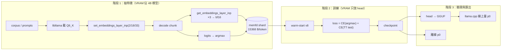

# AGENTS.md — spark-eagle3-forge

重訓 Spark-X2.6-4B（FIT-Q6_K abliterated）的 EAGLE-3 draft head，目標是提高**中文 + thinking** 語域下的 draft 接受率，藉投機解碼提升單序列 decode 速度。

上游公開頭 `VitreousCut/Spark-X2.6-4B-EAGLE3` v8 實測 p0 僅 0.013–0.429（英文/官方模型上是 0.46–0.92），收益不穩定。本專案要解決的就是這個落差。

> **文件分工**：本檔（`AGENTS.md`）只寫**可移植**的設計、模型性質與實驗結論，會隨 repo 公開。
> 所有機器相關資訊（硬體、絕對路徑、環境版本、原始 t/s）放在 `AGENTS.local.md`，
> 該檔已列入 `.gitignore`，模板為 `AGENTS.local.md.example`。

---

## 1. 硬性約束（不可違反）

使用者明確要求，任何方案都必須同時滿足：

1. **不降低 KV 精度**（維持 f16）
2. **不縮小上下文**（維持 131072）
3. **不降低量化精度**（維持 Q6_K）
4. **訓練特徵放記憶體，不要反覆寫 NVMe**（保護 SSD 壽命）

約束 1–3 排除了「降 KV 位寬」「縮 ctx」「換 Q4」這類最直接的加速手段，因此唯一剩下的槓桿是**一次前向驗證多個 token**（投機解碼）。

---

## 2. 已驗證的事實（勿重複推導）

### 2.1 執行環境

設計目標是一張 **12 GiB 級消費級 GPU + 一般桌上型 RAM** 的單機環境。
所有絕對數字（GPU 型號、RAM 容量、磁碟型號、各項 t/s 與反推頻寬）屬於**特定機器**，
記錄在 `AGENTS.local.md`（未入庫；模板 `AGENTS.local.md.example`）。

影響設計的通用約束：

| 約束 | 對設計的影響 |
|---|---|
| VRAM ≤ 12 GiB | target（4B，bf16 約 8 GiB）與 head 訓練態（約 4 GiB）**無法同時常駐** → 必須兩階段 |
| tmpfs 預設為 RAM 的 50% | 特徵緩衝**不可**依賴 `/dev/shm` 的預設容量 |
| 常無 swap | 超量配置直接觸發 OOM killer（無乾淨報錯） → 特徵容量必須前置檢查 |
| CUDA 常不在 PATH | 編譯需顯式 `-DCMAKE_CUDA_COMPILER=$CUDA_HOME/bin/nvcc` |

### 2.2 模型架構（`spark2_5`）

```
block_count 36 / hidden 2560 / ffn 10240 / heads 16 / kv_heads 4 / head_dim 256
sliding_window 512，pattern 3:1 → 27 層 sliding + 9 層 full attention
rope.base 5e6（global 僅 64 維）、rope_freq_base_swa 1e4
tie_word_embeddings = true（GGUF 只有 token_embd.weight，無 output.weight）
vocab 131072 / ctx_train 1048576
```

GGUF 張量共 **290 個 = 2 + 36×8**：

```
token_embd.weight, output_norm.weight
blk.N.{attn_norm, attn_qkv(融合), attn_gate, attn_output, ffn_norm, ffn_gate, ffn_up, ffn_down}
```

注意：`attn_qkv` 是融合的 `[2560, 6144]`（q 4096 / k 1024 / v 1024），`attn_gate` 是逐頭 `[2560, 16]`。
**若日後真的需要轉回 HF safetensors，這是唯一要手工處理的地方。**

### 2.3 基線效能（可移植的結論）

設定：`-c 131072 -ctk f16 -ctv f16 -ngl 99 -fa on --parallel 1`（Q6_K）。

每 token 需讀 `3.379 GB（權重） + n_past × 36 KiB（KV，僅 9 層 full；27 層 sliding 只需 512 窗）`。
實測有效頻寬落在**規格頻寬的 73–78%** → **純 bandwidth-bound**，decode 隨 ctx 線性下降；
短 ctx 的 roofline 約為實測值的 **1.35–1.4 倍**（差距來自 Q6_K matvec 的有效頻寬損失）。

> 絕對 t/s 與反推頻寬見 `AGENTS.local.md` §4.1（與硬體綁定，不宜當作通用基準）。

已排除的無效手段（實測）：
- `GGML_CUDA_FORCE_MMQ=1`、`GGML_CUDA_FORCE_CUBLAS=1`：與基線相同
- `--spec-type ngram-mod`：比 ngram-simple 差
- `--spec-type ngram-simple`：僅 +3~9%（可留著當免費收益，非本專案重點）

### 2.4 公開 v8 頭的實測表現（改前基準）

6 個工作負載：`prose_nothink`、`prose_think`、`chat_nothink`、`chat_think`、`code`、`copy`。
`p0` = draft 首 token 被 target 接受的比例（與硬體無關，可跨機器比較）。

| 工作 | p0 @ temp 0.7 | p0 @ temp 1.0 |
|---|---:|---:|
| 中文散文 / 不思考 | 0.013 | 0.012 |
| 中文散文 / thinking | 0.257 | 0.058 |
| 中文 chat / 不思考 | 0.072 | 0.072 |
| 中文 chat / thinking | **0.328** | **0.171** |
| 程式碼 | 0.324 | 0.356 |
| 改寫既有檔案 | 0.429 | 0.416 |

兩個關鍵觀察：

- 同一批 prompt，**temp 1.0 → 0.7 讓 `chat_think` 的 p0 幾乎翻倍**（0.171 → 0.328）
  → 降溫是零成本的加速手段
- 散文不思考（0.013）遠低於打平點 0.12 → 該語域開投機解碼反而變慢

> 絕對 t/s、`n-max` 2/3 與 `p-min` 的完整掃描見 `AGENTS.local.md` §4。
> 量測為 6 個固定 prompt、單次 256 token；**p0 噪音約 ±0.03**，判讀關卡見 §7。

### 2.5 投機解碼的成本模型（本專案的核心公式）

實測驗證 pass 的固定成本為 **+12%**，因此：

$$\text{加速} = \frac{1 + p_0}{1.12} \qquad \text{打平點 } p_0 \approx 0.12$$

| p0 | 0.05 | 0.12 | 0.25 | 0.33 | 0.43 | 0.55 | 0.68 |
|---|---:|---:|---:|---:|---:|---:|---:|
| 加速 | 0.94x | 1.00x | 1.12x | 1.19x | 1.28x | 1.38x | 1.50x |

其他已驗證的推論參數結論：
- **`n-max` 必用 1**：2 與 3 在全部工作負載都更差
- `--spec-draft-p-min` 0.3/0.6/0.8 **無效**（把 chat 不思考拉回 3%，卻吃掉 thinking 的增益）
- `probabilistic` vs `greedy`：差距在噪音內（temp 1.0 略優 prob，temp 0.7 略優 greedy）
- **`draft-eagle3` 的 draft 端永遠取 argmax**（`common/speculative.cpp:869`），`--spec-draft-sampling` 只影響驗證端 → **訓練目標必須是「target 的 argmax」**

### 2.6 llama.cpp 能力（已驗證）

- 版本 0.7.0-dev build 11852；`--spec-type` 支援 `draft-mtp|eagle3|dflash|dspark|ngram-*`
- `spark2_5` **原本不填** `res->t_layer_inp[il]`，EAGLE-3 會 `GGML_ASSERT` 中止
- `libllama.so` **匯出**（可從 Python/自訂 C 呼叫）：
  ```c
  void    llama_set_embeddings_layer_inp(llama_context*, uint32_t lid, bool enable);
  float * llama_get_embeddings_layer_inp(llama_context*, uint32_t lid);
  ```
  緩衝為 **F32**、大小 `n_embd × n_batch`、逐層獨立（`src/llama-context.cpp:2409`）
- 但 `llama-ext.h` 在 `src/` 下（非 `include/`）→ 標頭非公開，**呼叫端要自己宣告原型或編譯 shim**
- 且該標頭的宣告**不在 `extern "C"` 區塊內**（`nm -D` 顯示 mangled 名）→ shim **必須用 C++ 編譯**，純 C 連不上

### 2.7 draft 詞表只有 32K（p0 的硬性上限）

`eagle3` 頭的輸出維度是 **32000**（`draft_vocab_size`，`lm_head.weight = [32000, 2560]`），
runtime 用 `d2t` 把這 32000 個 logits 散射回 131072 的 target 詞表，其餘一律 `-INFINITY`
（`src/models/eagle3.cpp:307`）。因此

$$p_0 \le \text{coverage} \equiv \Pr\big[\text{target argmax} \in \text{draft vocab}\big]$$

實測 coverage@32K（Q6_K，`sp_gen_cli` 用模型自己的 chat template 生成 256 token、temp 0.7）：
中文散文 **0.04**、中文閒聊 **0.08**、中文數學 thinking **0.79**、code **0.77**、copy **0.54**。

根因不是語域差距，而是**這個 32K 詞表幾乎不含中文**：一段 171 token 的中文 prompt 只有 7 個
token（4.1%）在集合內，`，`/`的`/`在`/`。`/`有` 全部缺席；重建的 id 與官方 GGUF 的 `d2t` 逐元素相同。
中文數學之所有有 0.79，是因為該樣本以 ASCII/LaTeX 為主——這不是 Chinese thinking 的代表值。

→ **只微調現有頭，中文 p0 不可能顯著改善**（天花板 ≈ 0.04–0.08，實測散文 0.013 已接近上限）。
要提升中文必須**重建 `d2t` 讓它涵蓋 CJK**，並重訓 `lm_head`。

現行詞表的問題不只是「沒有中文」：按 token 種類分解 2002 個真實使用 step，
含 CJK 的 token（52.0%）只有 **1.1%** 命中，純 ASCII 的 token（48.0%）也只有 **49.9%** 命中。
加總 coverage **0.245** → 1.11x，低於 G4 的 1.19x。但同一批 step 只用到 722 個相異 token，
可見 32K 的**容量**足夠，問題在**選字**。

已用公開語料（COIG-CQIA / firefly / zh-wikipedia / llama.cpp 原始碼）重建一版 32K 詞表並驗證：
新詞表 84.8% 的 id 含 CJK，同一批 step 的 coverage **0.245 → 0.939**（上限 1.73x）。
選字工具見 `scripts/build_vocab.py`、`scripts/eval_vocab.py`，流程見 `docs/notes.md` §2c。
`scripts/init_head.py` 會把 v8 其餘參數原樣搬過去，只重建 `lm_head`（4,243 列沿用、27,757 列重新初始化）。
`d2t` 張量的 `ne[0]` 決定 draft 詞表大小（`src/models/eagle3.cpp:47`），
所以調整詞表大小**不需要改 runtime**，但 `lm_head` 的行語意會變（不可 warm-start）。

> 詳細量測與 `d2t` / `t2d` 語意見 `docs/notes.md`。

---

## 3. 關鍵決策

| 決策 | 選擇 | 理由 |
|---|---|---|
| **特徵來源** | **llama.cpp（Q6_K 本體）** | ① 零下載、零轉換風險（免拆融合 qkv）② 與部署**完全同一份權重**，train/deploy 特徵一致 ③ 不需要 transformers / accelerate / 自訂 modeling 程式碼 |
| 訓練框架 | 純 PyTorch（自寫 1 層 decoder） | head 只有 218M 參數；不依賴 transformers 版本相容性 |
| 訓練目標 | **CE against target argmax** | runtime 只能提 argmax；作者實測 relabel 讓接受率 0.49→0.81 |
| 第二段 loss | training-time test（回饋自身輸出） | 作者實測 p0 0.50→0.70，是 `n_max>1` 有效的關鍵 |
| 特徵精度 | **bf16**（llama.cpp 給 F32，落地前四捨五入到 bf16） | 容量翻倍（2.79M vs 1.4M token）。**注意：v8 的 safetensors 是全 F32**（GGUF 才是轉檔時轉 bf16），所以 bf16 是我們的取捨、不是沿襲；需在 S1 以同一批資料比對 p0。evaluator 必須同樣捨入 |
| 特徵存放 | **memfd（`os.memfd_create`）+ mmap** | 純 RAM、**不受 tmpfs 配額限制**、不寫 NVMe、不需 root。超量行為是 OOM（故須前置檢查容量） |
| 單輪容量 | **40 GiB ≈ 2.79M token** | RAM 可用量 − ~10 GiB 訓練固定開銷，再留 3 GiB 餘裕（本機值見 `AGENTS.local.md`） |
| 分段方式 | 每段 extract → train → **立刻存 checkpoint** | 記憶體特徵行程死掉即遺失，最壞只損失一段 forward（約 12 分鐘） |
| 起點 | warm-start v8 safetensors，**但 `lm_head` 必須重訓** | 保留既有 code/英文能力；新舊詞表只有 4,243/32,000 列重疊（§2.7），其餘列重新初始化 |

### 為何不用「轉 BF16 safetensors + transformers」

- 要下載 8.2 GB 並自行處理融合 `attn_qkv` 拆分與 `attn_gate` 命名 → 引入可避免的失敗點
- 特徵來自 BF16 權重，推論來自 Q6_K → 存在 train/deploy 落差
- 改走 llama.cpp 後，**取出的特徵與 runtime 餵給 head 的位元組完全一致**，直接消滅一整類 bug

### 記憶體預算（訓練階段）

| 項目 | 大小 |
|---|---:|
| head fp32 參數（218,277,120） | 873 MB |
| 梯度 | 873 MB |
| AdamW 2 階 | 1.75 GB |
| target `token_embd`（head 不自帶，從 GGUF 反量化為 bf16） | 671 MB |
| Python + torch + CUDA host | ~2.5 GB |
| pinned staging / 碎片餘裕 | ~3.5 GB |
| **固定開銷** | **~10 GiB** |

**已知陷阱**：`/dev/shm` 預設只有 RAM 的 50%，容量因機器而異（常見 32 GiB 級）。特徵容量一旦超過就 OOM。要更大必須用 memfd（`os.memfd_create`），或由 root remount。

---

## 4. 系統架構（三階段）



階段 1 與 2 **不可同時**（target 8.2 GiB + head 訓練態 4.3 GiB > 12 GiB VRAM）。

---

## 5. 特徵格式（已定案）

每 token 固定 **15,368 B**，直接 mmap 成結構陣列：

| offset | 型別 | 內容 |
|---:|---|---|
| 0 | bf16[3][2560] | layer 2 / 18 / 33 的**輸入** hidden state（15,360 B），位置 `p` |
| 15360 | int32 | `token_id` = **`token[p+1]`**（供 embedding lookup；注意是 shift-left） |
| 15364 | int32 | `argmax_id` = **`argmax[p+1]`**（target 在該位置的 next-token argmax，即訓練標籤） |

**為何是 `p+1`**：runtime 的 draft 在記憶體位置 P 吃的是 `(token[P+1], g_embd[P])`
（`common/speculative.cpp:747`）。若這裡存成同一位置的 token，head 會學到錯位的目標，
而且只有到 G1 才會發現。

驗證：G0 檢查 `layer_inp[0]` 是否等於 `llama_model_get_tok_embd_rows()` 的同一列——
通過即代表層索引、token-major 佈局與 bf16 轉換同時正確（實測 max|diff| ≈ 3e-4，即 bf16 捨入量級）。

```json
// shard-NNNN.meta.json
{ "n_tokens": 2794722, "seq_lens": [2048, 2048, ...],
  "layers": [2, 18, 33], "dtype": "bf16", "n_embd": 2560,
  "model": "Spark-X2.6-4B-abliterated-FIT-REFERENCE-3G-Q6_K.gguf",
  "model_sha256": "…", "corpus": "…", "created": "…" }
```

容量換算（15,368 B/token）：

| 容量 | token 數 |
|---|---:|
| 8 GiB | 559K |
| 32 GiB | 2.24M |
| **40 GiB** | **2.79M** |
| 22M token 全量 | 需 338 GB |

**坑**：`d2t` 在 safetensors 是**差值**儲存，轉 GGUF 時才 `+arange` 還原（作者註記）；我們沿用 v8 的 d2t，不重算。

---

## 6. 目錄結構

```
spark-eagle3-forge/
├── AGENTS.md                 # 本文件
├── csrc/
│   ├── CMakeLists.txt        # 以 -DLLAMACPP_ROOT=… 設定
│   ├── spark_feat.cpp        # **C++** shim：包 libllama 的特徵抽取，對外導出純 C ABI
│   └── sp_feat_cli.cpp       # M1/G0 harness：decode、抽特徵、印 JSON、算 coverage
├── spark_eagle3/
│   ├── llamacpp.py           # 載入 shim、tokenize、decode、回傳 numpy
│   ├── feats.py              # memfd 特徵緩衝、容量前置檢查、shard 寫入
│   ├── extract.py            # 階段 1：corpus → shard
│   ├── model.py              # EAGLE-3 head（1 層 decoder + fc + d2t）
│   ├── train.py              # 階段 2：warm-start + 雙 loss
│   ├── eval_p0.py            # 離線 p0 與等效加速比
│   └── export_gguf.py        # head → eagle3 GGUF
├── configs/
│   ├── s1_smoke.yaml         # 32K token
│   └── s2a_public.yaml       # 2.79M token
├── scripts/
│   ├── run_s1.sh
│   └── run_s2a.sh
├── datasets/                 # gitignored
├── checkpoints/              # gitignored
├── logs/                     # gitignored
└── docs/
    └── notes.md              # 設計筆記（不含機器數據；機器數據放 AGENTS.local.md）
```

---

## 7. 驗證關卡（硬性，不達標就停下）

| 關卡 | 條件 | 不通過的意義 |
|---|---|---|
| **G1 特徵正確性** | 離線 p0 與 llama.cpp 線上 p0 差距 **< 0.03** | 層索引或佈局接錯 |
| G2 可匯出 | 訓好的 head 能轉 GGUF 且 llama.cpp 無 assert 載入 | 轉換器有問題 |
| **G3 探針（S2a）** | `chat_think` p0 **0.17 → ≥ 0.25** | 資料方向錯，停手 |
| G3b 不遺忘 | `code` p0 **不低於 0.356** | 過擬合或災難性遺忘 |
| G4 上線標準 | `chat_think` p0 ≥ **0.33**（→ 1.19x） | 才值得換掉 v8 |

**已通過**：G0（特徵自洽，max\|diff\| 3e-4）、G1（平均離線 0.147 vs 線上 0.133，差 0.014；
見 `docs/notes.md` §5c）。G0/G1 都不需要訓練，用現成的 v8 頭即可複驗。

`n-max` 一律固定 1；greedy 為主，probabilistic 只在 temp=1.0 時作對照。

---

## 8. 使用方式（規劃中的命令）

路徑一律由環境變數提供（見 §9）。

```bash
# 階段 1：抽特徵（40 GiB memfd）
python -m spark_eagle3.extract --config configs/s2a_public.yaml

# 階段 2：訓練（warm-start v8）
python -m spark_eagle3.train --config configs/s2a_public.yaml --init v8

# 階段 3：匯出 + 線上量測
python -m spark_eagle3.export_gguf --ckpt checkpoints/head.pt --out head.gguf
LLAMA="$LLAMACPP_ROOT/build/bin/llama" \
SPEC_NMAX=1 SPEC_SAMPLING=greedy EAGLE="$OUT_HEAD_GGUF" "$SPARK_START"
```

---

## 9. 外部依賴與路徑

本 repo **不記錄任何絕對路徑**。所有本機位置由環境變數提供（完整值見 `AGENTS.local.md`）：

| 變數 | 用途 |
|---|---|
| `LLAMACPP_ROOT` | llama.cpp 工作區（需含 `build/bin/llama`，且 `spark2_5` 已 patch） |
| `MODELS_DIR` | target Q6_K GGUF 與 v8 頭 GGUF 所在目錄 |
| `SPARK_START` | 啟動 llama-server 的腳本 |
| `PYTHON_ENV` | 已安裝 torch / safetensors / gguf 的 Python 環境 |

必要的 llama.cpp 狀態（可移植描述）：

1. `src/models/spark2-5.cpp` 需加入 `res->t_layer_inp[il] = inpL;`，否則 EAGLE-3 會在 `llama-graph.cpp` 的 `GGML_ASSERT` 中止
2. 需以 `-DGGML_CUDA=ON` 編譯；因 `llama-ext.h` 位於 `src/`（非 `include/`），自訂 shim 需自行宣告原型
3. 執行期參數：`-c 131072 -ctk f16 -ctv f16 -ngl 99 -fa on --parallel 1`

> 版本、commit、安裝路徑與環境版本見 `AGENTS.local.md`。

---

## 10. 需要下載 / 安裝的東西

| 項目 | 大小 | 狀態 |
|---|---:|---|
| `VitreousCut/Spark-X2.6-4B-EAGLE3` 的 `v8/model.safetensors` + `v8/config.json` | 874 MB | **必下** |
| `safetensors` Python 套件 | ~1 MB | ✅ 已裝 0.8.0 |
| 公開語料（S2a）：COIG-CQIA / firefly、chinese-fineweb-edu、codeparrot-clean | ~2.3 GB | S2a 時再下 |
| ~~`SC117/...-BF16.gguf`~~ | 8.2 GB | **不需要**（改走 llama.cpp 抽特徵） |
| ~~`XHToken/.../modeling_spark.py`、transformers、accelerate~~ | — | **不需要** |

---

## 11. 風險與陷阱

| 風險 | 對策 |
|---|---|
| memfd 超量 → OOM killer 無聲殺行程 | 寫入前檢查 `n_tokens × 15368 ≤ 預算`；每段訓完立刻存 checkpoint |
| 常無 swap；桌面環境佔用 RAM/VRAM | 訓練前釋放桌面佔用（關瀏覽器、桌面移至 iGPU） |
| `llama-ext.h` 非公開標頭 | 在 `csrc/` 寫 shim 編譯成 `.so`，**不要**用 ctypes 猜 struct 佈局 |
| `llama-ext.h` 的函式是 C++ linkage | shim 必須用 **C++** 編譯並手動宣告原型，不能用純 C |
| draft 詞表 32K 鎖住 p0 上限（§2.7） | 訓練前先量各語域 coverage；不足就先換詞表，別急著訓練 |
| 特徵 F32 → bf16 的捨入 | evaluator 也要同樣捨入，確保 train/eval 一致 |
| `context-shift` 改變位置編碼 | extract 時固定 chunk、不啟用 context shift |
| chunk 邊界 | 每 chunk 多存 1 個 token 以取 shift 後的 argmax |
| RoPE 維度不同於一般模型（64 維 global / 256 swa） | 一律由 llama.cpp 計算，Python 端不自己算位置 |
| 匯出 GGUF 時 `num_hidden_layers ≠ 1` | converter 只認 1 層，匯出時強制 1 |

---

## 12. 不要做的事

- ❌ 不要 `git push`，僅提交清晰規範的 commit，由用戶審查後自行提交
- ❌ 不要修改 `$LLAMACPP_ROOT` 的 `master` 分支（改動只留在本機分支）
- ❌ 不要用 `pkill -f <模糊關鍵字>`；要用完整路徑
- ❌ 不要降低 KV 精度 / 縮小 ctx / 降低量化精度（見 §1）
- ❌ 不要訓練 `spark2_5` 的 MTP graph（EAGLE-3 已有現成權重與 runtime 支援，成本差一個量級）
- ❌ 不要讓特徵容量逼近 RAM 上限（必須先扣除 ~10 GiB 訓練固定開銷，再留餘裕）

---

## 13. 里程碑

| 階段 | 內容 | 牆鐘 | 產出 |
|---|---|---:|---|
| S1 | 32K token 端到端 + G1 關卡 | 1 h | 證明特徵抽取正確 |
| S2a | 2.79M token（公開語料）+ 8k steps + G3 | 1 h | 決定是否需補 on-policy 資料 |
| S2b | 條件執行：生成 ~1.2M token 中文 thinking traces | 半天 | 若 S2a 未達標 |
| S3 | 擴量至 11 段（22M token 等級） | 2.4 h/輪 | 最終 head |

---

## 14. 公開前的注意事項

本 repo 將會公開。**任何只在本機成立的事實都不得進到 tracked 檔案。**

| 類別 | 例子 | 放哪裡 |
|---|---|---|
| 硬體型號 / 容量 | GPU 型號、VRAM、RAM、磁碟型號與 TBW | `AGENTS.local.md` |
| 絕對路徑 / 環境名稱 | `$HOME/...`、conda env 名、自製腳本名 | `AGENTS.local.md`（程式用 `$ENV_VAR`） |
| 原始效能數據 | 絕對 t/s、prefill 速率、反推頻寬 | `AGENTS.local.md` |
| 個人識別 | email、主機名、登入名 | 不寫入任何檔案；commit 用 GitHub noreply |

**可公開的**：模型架構、GGUF 張量佈局、llama.cpp API 與版本、p0 / 接受率 / 相對加速比、
實驗結論（哪些參數無效）、演算法設計。這些是可重現的研究成果。

### 檢查指令

```bash
scripts/check_public.sh          # 掃描 tracked 檔案；退出碼 1 = 有發現
scripts/install_hooks.sh         # 裝成 pre-commit hook（只在本地 .git/hooks，需各自 opt-in）
```

自訂關鍵字（你的型號、env 名等）寫在 **未追蹤** 的 `.check_public.extra`：

```bash
EXTRA=( 'MyGpuModel' 'my-env-name' 'my-hostname' )
```

### 已做過的歷史清理

初始化 commit 曾經包含硬體與路徑，已在 push 前用 `git commit --amend` 重寫；
`origin/main` 從未包含這些內容。若曾 push 過，則必須 `git filter-repo` 或
GitHub 支援才能清除——**所以「先檢查再 commit」比事後補救重要得多**。
