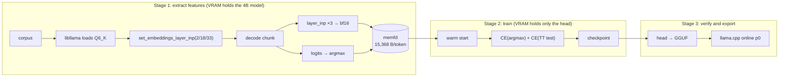

# AGENTS.md — spark-eagle3-forge

Retrain the EAGLE-3 draft head for Spark-X2.6-4B (FIT-Q6_K abliterated). The goal is a higher
draft acceptance rate in the **Chinese + thinking** register, so speculative decoding speeds up
single-sequence decode.

The upstream public head `VitreousCut/Spark-X2.6-4B-EAGLE3` (v8) only reaches p0 0.01–0.33 in
Chinese, against 0.46–0.92 in the author's English setup, so its payoff is unstable. That gap is
what this project is about.

> **Documentation layout**
> - This file: purpose, design, plan, **commands that actually work**, caveats. Published with the repo.
> - `docs/facts.md`: core facts (model geometry, cost model, vocabulary ceiling, llama.cpp changes).
>   §2 below is only an index.
> - `docs/notes.md`: measurements, derivations, failed attempts (portable, published).
> - `AGENTS.local.md`: hardware, absolute paths, environment versions, raw t/s (**gitignored**,
>   template in `.example`).

## 0. Where we are

G0 and G1 both pass and the draft vocabulary has been rebuilt (coverage 0.245 → 0.939), so
everything up to stage 1 is verified and reproducible with the released v8 head alone.
**S2a training is the next step.** Gates in §8, stages in §11, evidence in `docs/notes.md`
(its first section is the v8 baseline p0 table).

## 1. Hard constraints (non-negotiable)

Every approach must satisfy all of these:

1. **Do not reduce KV precision** (keep f16)
2. **Do not shrink the context** (keep 131072)
3. **Do not reduce quantisation precision** (keep Q6_K)
4. **Keep training features in memory; do not rewrite NVMe**
5. **Write `AGENTS.md`, everything under `docs/`, and all code comments in English.**
   Test data and prompts may stay Chinese where the language itself is the subject.

Constraints 1–3 rule out narrower KV, shorter context and Q4, which leaves one lever:
**verify multiple tokens per forward pass** (speculative decoding).

## 2. Core facts

Derivations and measurements live in [`docs/facts.md`](docs/facts.md). Index only:

- [2.1 Model and runtime](docs/facts.md#21-model-and-runtime) —
  depth, width, RoPE, tied embedding, and the four constraints a 12 GiB single machine imposes
- [2.2 Cost model](docs/facts.md#22-cost-model-the-core-formula) —
  $\text{speed-up}=(1+p_0)/1.12$, break-even 0.12, `n-max` must be 1, the training target must be
  the target model's argmax
- [2.3 The hard ceiling on p0](docs/facts.md#23-the-hard-ceiling-on-p0-a-32k-draft-vocabulary) —
  $p_0 \le$ coverage, v8's vocabulary is almost entirely ASCII, rebuilding takes it 0.245 → 0.939
- [2.4 llama.cpp changes required](docs/facts.md#24-llama.cpp-changes-required) —
  the `t_layer_inp` patch, a private header, and why the shim must be C++

## 3. Design decisions

| Decision | Choice | Reason |
|---|---|---|
| Feature source | **llama.cpp (the Q6_K weights)** | Same weights as deployment, so train and deploy see identical features; no 8.2 GB download and no fused-qkv surgery |
| Training framework | Plain PyTorch (hand-written single decoder layer) | 218M parameters; no exposure to transformers version churn |
| Training target | CE against the **target's argmax** | The runtime only ever proposes an argmax; the author measured relabelling taking acceptance 0.49 → 0.81 |
| Second loss term | Training-time test (feed the draft its own output) | The author measured p0 0.50 → 0.70 |
| Feature precision | bf16 (llama.cpp gives F32; round-to-nearest-even before storing) | Doubles capacity. **v8's weights are F32**, so bf16 is our trade-off, not an inheritance; the evaluator must round the same way |
| Feature storage | **memfd + mmap** | Pure RAM, no tmpfs quota, no NVMe writes, no root |
| Starting point | v8 warm start, **`lm_head` retrained** | Only 4,243 of 32,000 rows overlap; the rest are re-initialised |
| Segmentation | extract → train → checkpoint immediately, per segment | Features live in RAM; a dead process loses them |

### Memory budget (training)

| Item | Size |
|---|---:|
| head fp32 parameters + gradients | 1.75 GB |
| AdamW moments | 1.75 GB |
| target `token_embd` (bf16) | 671 MB |
| Python + torch + CUDA host | ~2.5 GB |
| pinned staging / fragmentation headroom | ~3.5 GB |
| **Fixed overhead** | **~10 GiB** |

## 4. Architecture



Stages 1 and 2 **cannot** run at the same time.

### Feature format (settled)

A fixed **15,368 B** per token, mmap'd as a struct array:

| offset | type | contents |
|---:|---|---|
| 0 | bf16[3][2560] | **input** hidden state of layers 2 / 18 / 33 at position `p` |
| 15360 | int32 | `token[p+1]` (embedding lookup, **shift-left**) |
| 15364 | int32 | `argmax[p+1]` (training label) |

The runtime draft at position P consumes `(token[P+1], g_embd[P])`
(`common/speculative.cpp:747`), so storing the same-position token teaches the head a shifted
target — and that only surfaces at G1.

Capacity: 8 GiB ≈ 559K tokens, 32 GiB ≈ 2.24M, **40 GiB ≈ 2.79M**; 22M tokens needs 338 GB.

## 5. Directory layout

```
spark-eagle3-forge/
├── csrc/
│   ├── CMakeLists.txt         # -DLLAMACPP_ROOT=…
│   ├── spark_feat.cpp         # C++ shim: feature extraction, pure C ABI outward
│   ├── sp_feat_cli.cpp        # G0 harness: extract, print JSON, report coverage
│   └── sp_gen_cli.cpp         # coverage probe: generate with the chat template, count hits
├── spark_eagle3/
│   ├── llamacpp.py            # ctypes binding (tokenize / decode / features / argmax)
│   ├── feats.py               # memfd feature buffer, up-front capacity check
│   ├── corpus.py              # COIG / firefly / wikipedia / plain-text readers
│   ├── extract.py             # stage 1: corpus → memfd shard
│   ├── model.py               # EAGLE-3 head (v8 parameter names)
│   ├── eval_p0.py             # offline p0 replay
│   ├── train.py               # ⬜ stage 2
│   └── export_gguf.py         # ⬜ head → GGUF
├── scripts/
│   ├── fetch_corpora.sh       # download corpora into datasets/raw/
│   ├── build_vocab.py         # build a candidate d2t from token frequency
│   ├── eval_vocab.py          # score a candidate vocabulary on recorded steps
│   ├── init_head.py           # v8 → warm-start checkpoint aligned to the new vocabulary
│   ├── make_prompts.py        # render probes with the model's own chat template
│   ├── g1_online.py           # online p0 through llama-server
│   ├── check_public.sh        # leak check (also installed as a pre-commit hook)
│   └── install_hooks.sh       # install that hook locally
├── configs/                   # reserved for stage configs; currently empty
├── .vscode/                   # settings.json (compile_commands.json) + tasks.json
├── datasets/  checkpoints/  logs/     # all gitignored
├── AGENTS.md                  # this file
├── AGENTS.local.md.example    # template for the gitignored machine-specific file
├── CLAUDE.md                  # points at AGENTS.md
├── README.md
└── docs/
    ├── facts.md               # core facts (§2 of this file expands here)
    └── notes.md               # measurements, derivations, open questions
```

## 6. Commands (verified)

All commands run from the repo root. Two environment variables must be set first (see §7):

```bash
export LLAMACPP_ROOT=…      # llama.cpp checkout carrying the spark2_5 patch
export MODELS_DIR=…         # holds <target>.gguf and spark-eagle3-v8.gguf
```

Python is the environment linked as `.venv` in the repo root (torch / safetensors / gguf).
Call it explicitly so a different interpreter does not get picked up:

```bash
.venv/bin/python -m spark_eagle3.extract …
```

Anything that loads the shim also needs:

```bash
export LD_LIBRARY_PATH="$LLAMACPP_ROOT/build/bin:$LD_LIBRARY_PATH"
export PYTHONPATH=.
```

### Build once

```bash
# Build the shim (also emits compile_commands.json for the editor)
cmake -S csrc -B csrc/build -G Ninja -DLLAMACPP_ROOT="$LLAMACPP_ROOT"
cmake --build csrc/build
```

### Setup steps already done (re-run only if an input changes)

```bash
# Render probes with the model's own chat template; without it the target goes off-distribution
.venv/bin/python scripts/make_prompts.py --model "$MODELS_DIR/<target>.gguf" \
    --out-dir datasets/prompts/rendered --set realistic

# Coverage: generate and count how often the draft vocabulary would hit
csrc/build/sp_gen_cli --model "$MODELS_DIR/<target>.gguf" \
    --d2t datasets/v8/d2t_target_ids.i32 \
    --prompt-file datasets/prompts/rendered/zh_tech.txt \
    --n-gen 256 --temp 0.7 --out-dir logs/cov

# Rebuild the vocabulary (equal character budget per domain) and score it
.venv/bin/python scripts/build_vocab.py --model "$MODELS_DIR/<target>.gguf" \
    --out datasets/vocab/d2t_v1_32k --vocab-size 32000 --chars-per-domain 40000000 \
    --code-dir "$LLAMACPP_ROOT/src"
.venv/bin/python scripts/eval_vocab.py logs/real/steps.i32 \
    datasets/v8/d2t_target_ids.i32 datasets/vocab/d2t_v1_32k.i32

# Warm-start checkpoint aligned to the new vocabulary
.venv/bin/python scripts/init_head.py --v8-dir datasets/v8 \
    --d2t datasets/vocab/d2t_v1_32k.i32 --out checkpoints/head_init.pt
```

### The regular cycle

```bash
# G0: feature self-consistency (no training needed)
csrc/build/sp_feat_cli --model "$MODELS_DIR/<target>.gguf" \
    --text AGENTS.md --ctx 1024 --tokens 512 --layers 0,2,18,33 --add-bos

# Stage 1: extract features
.venv/bin/python -m spark_eagle3.extract --model "$MODELS_DIR/<target>.gguf" \
    --max-tokens 32768 --chunk 2048 --d2t datasets/vocab/d2t_v1_32k.i32 \
    --out logs/shards/s1.json --text AGENTS.md \
    --coig datasets/raw/coig_cqia/COIG-CQIA-full.jsonl

# Stage 3 (no work needed): offline p0
.venv/bin/python -m spark_eagle3.eval_p0 --model "$MODELS_DIR/<target>.gguf" \
    --head datasets/v8 --dtype bfloat16 --n-gen 128 \
    --prompt-file datasets/prompts/rendered/zh_tech.txt --out logs/p0.json

# Stage 3: online p0 (llama-server's draft acceptance is p0)
.venv/bin/python scripts/g1_online.py \
    --server "$LLAMACPP_ROOT/build/bin/llama-server" \
    --model "$MODELS_DIR/<target>.gguf" --head "$MODELS_DIR/spark-eagle3-v8.gguf" \
    --prompt-file datasets/prompts/rendered/zh_tech.txt \
    --n-predict 128 --out logs/g1_online.json --server-log logs/g1_server.log
```

### What "verified" means here

There is **no test suite, no linter and no formatter** in this repo. Correctness is established by
the G0 and G1 commands above: G0 proves the feature layout and the bf16 cast, G1 proves the offline
replay reproduces llama.cpp's own draft acceptance. Do not introduce a pytest scaffold; add a gate
instead.

Committing runs `scripts/check_public.sh` as a pre-commit hook, so a commit can fail for a reason
that has nothing to do with the code — see §12.

## 7. External dependencies

The repo records **no absolute paths**; every location comes from an environment variable
(actual values in `AGENTS.local.md`):

| Variable | Purpose |
|---|---|
| `LLAMACPP_ROOT` | llama.cpp checkout (`build/bin/llama` present, `spark2_5` patched) |
| `MODELS_DIR` | holds the target Q6_K GGUF and `spark-eagle3-v8.gguf` |
| `SPARK_START` | script that launches llama-server |
| `PYTHON_ENV` | Python environment with torch / safetensors / gguf (the repo-root `.venv` symlink points at it) |

`<target>.gguf` in the commands below means whichever Q6_K build of Spark lives in `MODELS_DIR`.

Runtime flags: `-c 131072 -ctk f16 -ctv f16 -ngl 99 -fa on --parallel 1`.

Already downloaded (all under the gitignored `datasets/`):

| Item | Size | Status |
|---|---:|---|
| `v8/model.safetensors` + `config.json` + `train_log.json` | 874 MB | ✅ sha256 verified |
| Upstream `llama.cpp-spark2_5-layer-inputs.patch` and model card | 8 KB | ✅ downloaded |
| COIG-CQIA / firefly-train-1.1M / zh-wikipedia (1 shard) | 1.9 GB | ✅ sha256 verified |

`Chinese-FineWeb-Edu` and `CCI3-Data` need login (401 / gated), so they are unused.

## 8. Gates (hard stops)

| Gate | Condition | Meaning if it fails |
|---|---|---|
| ~~G0 feature self-consistency~~ | `layer_inp[0]` == token embedding row | ✅ passed (3e-4) |
| ~~G1 offline ≈ online~~ | the two p0 values differ by **< 0.03** | ✅ passed (0.014) |
| G2 exportable | the trained head converts to GGUF and loads without an assert | the converter is wrong |
| **G3 probe (S2a)** | `chat_think` p0 **0.17 → ≥ 0.25** | the data points the wrong way; stop |
| G3b no forgetting | `code` p0 **not below 0.356** | overfitting or catastrophic forgetting |
| G4 ship | `chat_think` p0 ≥ **0.33** (→ 1.19x) | only then is it worth replacing v8 |

p0 noise is about ±0.03; do not read anything smaller as a signal.

## 9. Risks and pitfalls

| Risk | Mitigation |
|---|---|
| Oversized memfd → OOM killer takes the process silently | check capacity before writing; checkpoint after every segment |
| Desktop competing for RAM / VRAM | close browsers and move the desktop to the iGPU before training |
| `llama-ext.h` is private and C++-linked | compile the shim as C++ and declare the prototypes by hand; never guess struct layout with ctypes |
| The vocabulary caps p0 ([facts.md §2.3](docs/facts.md#23-the-hard-ceiling-on-p0-a-32k-draft-vocabulary)) | measure per-register coverage before training; change the vocabulary first if it is short |
| F32 → bf16 feature rounding | the evaluator must round identically so train and eval agree |
| Unusual RoPE geometry (64 dims global / 256 swa) | let llama.cpp compute positions; never replicate it in Python |
| Chunk boundaries | decode one extra token per chunk so the shifted label exists; clear the KV cache between chunks |
| Labels outside the draft vocabulary | mask them in the CE (`ignore_index`); never map them to an arbitrary id |
| `num_hidden_layers` on export | the converter only accepts 1; force it |
| Editor cannot find `llama.h` | CMake exports `compile_commands.json`; `.vscode/settings.json` points at it |

## 10. Do not

- ❌ `git push`; commit cleanly and let the user review and push
- ❌ modify the `master` branch of `$LLAMACPP_ROOT` (keep changes on a local branch)
- ❌ use `pkill -f <vague pattern>`; use a full path
- ❌ lower KV precision / shrink the context / lower quantisation precision (§1)
- ❌ train the `spark2_5` MTP graph (EAGLE-3 already has weights and runtime support)
- ❌ let feature capacity approach the RAM ceiling (subtract the ~10 GiB training overhead first)

## 11. Milestones

| Stage | Content | Status |
|---|---|---|
| S1 | End-to-end extraction + G1 | ✅ |
| **S2a** | 2.79M tokens (public corpora) + 8k steps + G3 | ⬜ in progress |
| S2b | Conditional: generate ~1.2M tokens of Chinese thinking traces | only if S2a misses |
| S3 | Scale to 22M tokens | final head |

### S2a plan

1. **Extract**: four domains mixed (COIG / firefly / wikipedia / code), chunk 2048, 40 GiB memfd
2. **`train.py`**: warm start from `checkpoints/head_init.pt`;
   loss = `CE(draft_logits, d2t_index(argmax))` + λ · `CE(TT test)`;
   positions whose label is outside the vocabulary use `ignore_index`
3. **Hyperparameters**: 8k steps, AdamW, lr 1e-4, bf16 autocast, grad clip 1.0
4. **Checkpoint** every 500 steps (features are in RAM; a dead process loses them)
5. **Acceptance**: G3 (`chat_think` ≥ 0.25) and G3b (`code` ≥ 0.356), measured with `eval_p0.py`

## 12. Before publishing (read before writing any file)

This repo is public. **Being documentation is not an exemption**: `AGENTS.md`, `docs/facts.md`,
`docs/notes.md` and every code comment are published verbatim, and prose is the easiest place to
leak. Treat a comment or a note exactly like a commit message.

### Never write these into any tracked file

| Leak | Examples that must not appear in a tracked file |
|---|---|
| Absolute paths | any path rooted at a home directory, a mount point or a drive letter |
| Environment names | a conda/venv name, or the target of a `.venv` symlink outside the repo |
| Identifiers | hostname, login name, e-mail address, `user@host` |
| Private / link-local IPs | `10.x`, `192.168.x`, `172.16-31.x`, `169.254.x` (loopback is harmless) |
| Hardware identity | GPU / CPU / disk model names, VRAM or RAM size, any serial-like string |
| Absolute performance | tokens/s, prefill rates, measured bandwidth |
| Local setup details | ports, the personal launch script, cache or session directories |
| Personal context | anything from a private conversation, dates tied to a person, quoted messages |

Those belong in `AGENTS.local.md` (gitignored); `AGENTS.local.md.example` shows the shape without
the values. Code reads them from `$ENV_VAR`, never from literals.

### Publishable

Model architecture, GGUF tensor layout, llama.cpp API behaviour, p0 / acceptance rates, relative
speed-ups, experimental conclusions, algorithm design — reproducible research results belong here.

### Checklist before every commit

```bash
scripts/check_public.sh       # scans tracked files; exit code 1 means findings
gitleaks git                  # use gitleaks to scan for information leaks
git diff --cached             # read it once against the table above
```

`check_public.sh` is also installed as a pre-commit hook by `scripts/install_hooks.sh`, so a commit
that trips it aborts and prints the offending file and pattern. Keywords the script cannot guess go
in the **untracked** `.check_public.extra`:
`EXTRA=( 'MyGpuModel' 'my-env-name' )`.

**When in doubt, leave it out.** A missing sentence costs one question; a leaked path costs a history rewrite.
