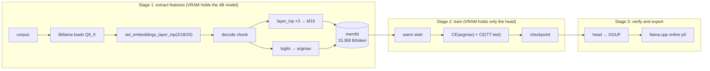

# AGENTS.md — spark-eagle3-forge

Retrain the EAGLE-3 draft head for Spark-X2.6-4B (FIT-Q6_K abliterated). The goal is a higher
draft acceptance rate in the **Chinese + thinking** workload, so speculative decoding speeds up
single-sequence decode. The scope has since widened to the whole bilingual NLP mix (translation,
summarisation, document organisation, chat), where the released S2b head is measured.

The upstream public head `VitreousCut/Spark-X2.6-4B-EAGLE3` (v8) only reaches p0 0.01–0.33 in
Chinese, against 0.46–0.92 in the author's English setup, so its payoff is unstable. That gap is
what this project is about.

> **Documentation layout**
> - This file: purpose, design, plan, **commands that actually work**, caveats. Published with the repo.
> - `docs/facts.md`: core facts (model geometry, cost model, vocabulary ceiling, llama.cpp changes).
>   §2 below is only an index.
> - `docs/notes.md`: measurements, derivations, failed attempts (portable, published).
> - `AGENTS.local.md`: hardware, absolute paths, environment versions, raw t/s (**gitignored**,
>   template in `.example`).

## 0. Where we are

Released head is **S2b (48K)**: D1 NLP mix p0 0.344 → 0.460, coverage 0.979–0.995
(`docs/notes.md` §11). It supersedes S2a (32K) on Chinese workloads. G0–G3c pass; **G4
belongs to S2a and missed by 0.002** (`chat_think` 0.3281 vs 0.33). S2b's own gates
(`docs/notes.md` §11f) pass except the online wall-clock A/B, not measured. Next is S3:
scale to 12–16M tokens with the S2b mixture. Protocol P and all run evidence:
`docs/notes.md` §6–§11.

P0 (`docs/notes.md` §13) then bounded what is left. The head's distribution overlap is no better
than its argmax match (0.362 / 0.411 against 0.421), so probabilistic drafting is not a lever until
the head is trained against a distribution. The runtime's second draft step keeps 0.107 of the
acceptances against 0.555 with the target's own hidden, capping `n-max 2` at +6.5%. The untrained
answer channel measures 0.385 against 0.493 in thinking, and p0 falls from 0.484 at 2k context to
0.219 at 32k. S3 therefore adds an answer-channel slice and 32k shards.

## 1. Hard constraints (non-negotiable)

Every approach must satisfy all of these:

1. **Do not reduce KV precision** (keep f16)
2. **Do not shrink the context** (keep the deployment context at 131072; 1048576 is the model's
   maximum capability, not the deployment setting)
3. **Do not reduce quantisation precision** (keep Q6_K)
4. **Keep training features in memory; do not rewrite NVMe**
5. **Write `AGENTS.md`, everything under `docs/`, and all code comments in English.**
   Test data and prompts may stay Chinese where the language itself is the subject.

Constraints 1–3 rule out narrower KV, shorter context and Q4, which leaves one lever:
**verify multiple tokens per forward pass** (speculative decoding).

## 2. Core facts

Derivations and measurements live in [`docs/facts.md`](docs/facts.md). Index only:

- [2.1 Model and runtime](docs/facts.md#21-model-and-runtime) —
  depth, width, RoPE, tied embedding, and the four constraints a 12 GiB single machine imposes
- [2.2 Cost model](docs/facts.md#22-cost-model-the-core-formula) —
  $\text{speed-up}=(1+p_0)/1.12$, break-even 0.12, `n-max` must be 1, the training target must be
  the target model's argmax
- [2.3 The hard ceiling on p0](docs/facts.md#23-the-hard-ceiling-on-p0-a-32k-draft-vocabulary) —
  $p_0 \le$ coverage, v8's vocabulary is almost entirely ASCII, rebuilding takes it 0.245 → 0.939
- [2.4 llama.cpp changes required](docs/facts.md#24-llama.cpp-changes-required) —
  the `t_layer_inp` patch, a private header, and why the shim must be C++

## 3. Design decisions

| Decision | Choice | Reason |
|---|---|---|
| Feature source | **llama.cpp (the Q6_K weights)** | Same weights as deployment, so train and deploy see identical features; no 8.2 GB download and no fused-qkv surgery |
| Training framework | Plain PyTorch (hand-written single decoder layer) | 218M parameters (32K head; 259M at 48K); no exposure to transformers version churn |
| Training target | CE against the **target's argmax** | The runtime only ever proposes an argmax; the author measured relabelling taking acceptance 0.49 → 0.81 |
| Second loss term | Training-time test (feed the draft its own output) | The author measured p0 0.50 → 0.70 |
| Feature precision | bf16 (llama.cpp gives F32; round-to-nearest-even before storing) | Doubles capacity. **v8's weights are F32**, so bf16 is our trade-off, not an inheritance; the evaluator must round the same way |
| Feature storage | **memfd + mmap** | Pure RAM, no tmpfs quota, no NVMe writes, no root |
| Draft head precision | **Q8_0** (`scripts/quantize_head.sh`; bf16 kept for A/B) | Same argmax as bf16 over 6144 NLP tokens, and 46% smaller draft file → +4.4% decode. The loader takes any GGML type; only `d2t` must stay I64 (`docs/notes.md` §12) |
| Starting point (S2a) | v8 warm start, **`lm_head` retrained** | Only 4,243 of 32,000 rows overlap; the rest are re-initialised |
| Starting point (S2a onward) | warm-start from the previous checkpoint on the same vocabulary | S2b = S2a → 48K union: keep 32,000 rows, randomly initialise 16,000 new rows (`docs/notes.md` §10b) |
| Segmentation | extract → train → checkpoint immediately, per segment | Features live in RAM; a dead process loses them |

Training memory detail lives in [`docs/facts.md §2.1`](docs/facts.md#21-model-and-runtime).

## 4. Architecture



Stages 1 and 2 **cannot** run at the same time.

### Feature format (settled)

A fixed **15,368 B** per token, mmap'd as a struct array:

| offset | type | contents |
|---:|---|---|
| 0 | bf16[3][2560] | **input** hidden state of layers 2 / 18 / 33 at position `p` |
| 15360 | int32 | `token[p+1]` (embedding lookup, **shift-left**) |
| 15364 | int32 | `argmax[p+1]` (training label) |

The runtime draft at position P consumes `(token[P+1], g_embd[P])`
(`common/speculative.cpp:747`), so storing the same-position token teaches the head a shifted
target — and that only surfaces at G1.

Capacity: 8 GiB ≈ 559K tokens, 32 GiB ≈ 2.24M, **40 GiB ≈ 2.79M**; 22M tokens needs 338 GB.

## 5. Directory layout

```
spark-eagle3-forge/
├── csrc/
│   ├── CMakeLists.txt         # -DLLAMACPP_ROOT=…
│   ├── spark_feat.cpp         # C++ shim: feature extraction, pure C ABI outward
│   ├── sp_feat_cli.cpp        # G0 harness: extract, print JSON, report coverage
│   └── sp_gen_cli.cpp         # coverage probe: generate with the chat template, count hits
├── spark_eagle3/
│   ├── llamacpp.py            # ctypes binding (tokenize / decode / features / argmax)
│   ├── feats.py               # memfd feature buffer, up-front capacity check
│   ├── corpus.py              # COIG / firefly / wikipedia / plain-text readers
│   ├── extract.py             # stage 1: corpus → memfd shard
│   ├── model.py               # EAGLE-3 head (v8 parameter names)
│   ├── eval_p0.py             # offline p0 replay (v8 dir, safetensors or a .pt checkpoint)
│   ├── diag.py                # P0 replay helpers: sampler, alpha overlap, p1, ctx probe
│   ├── train.py               # stage 2: extract → train → checkpoint, per segment
│   └── export_gguf.py         # head → GGUF for llama.cpp's draft-eagle3 loader
├── scripts/
│   ├── fetch_corpora.sh       # download corpora into datasets/raw/
│   ├── build_vocab.py         # build a candidate d2t from token frequency
│   ├── eval_vocab.py          # score a candidate vocabulary on recorded steps
│   ├── init_head.py           # v8 → warm-start checkpoint aligned to the new vocabulary
│   ├── make_prompts.py        # render probes with the model's own chat template
│   ├── g1_online.py           # online p0 through llama-server
│   ├── p0_diag.py             # P0: alpha overlap, two-step p1, channel and ctx probes
│   ├── d0_matrix.py           # D0: temperature × sampling × workload acceptance
│   ├── d0_report.py           # D0: aggregate the matrix into tables
│   ├── record_steps.py        # record greedy steps for vocabulary scoring
│   ├── build_union_vocab.py   # 48K union: keep the base ids, append English ids
│   ├── gen_nlp_data.py        # generate the S2b NLP corpus with the target
│   ├── train_s2b.py           # S2b: contiguous features + mixed-token TTT
│   ├── check_public.sh        # leak check (also installed as a pre-commit hook)
│   └── install_hooks.sh       # install that hook locally
├── configs/                   # reserved for stage configs; currently empty
├── .vscode/                   # settings.json (compile_commands.json) + tasks.json
├── datasets/  checkpoints/  logs/     # all gitignored
├── AGENTS.md                  # this file
├── AGENTS.local.md.example    # template for the gitignored machine-specific file
├── CLAUDE.md                  # points at AGENTS.md
├── README.md                  # English, the public front page
├── README.cn.md               # 简体中文
├── THIRD-PARTY-NOTICES.md     # upstream model / dataset / framework licences
└── docs/
    ├── facts.md               # core facts (§2 of this file expands here)
    └── notes.md               # measurements, derivations, open questions
```

## 6. Commands (verified)

All commands run from the repo root. Every command needs two variables; §7 lists two more
as local conveniences:

```bash
export LLAMACPP_ROOT=…      # llama.cpp checkout carrying the spark2_5 patch
export MODELS_DIR=…         # holds <target>.gguf and the released head
```

Python is the environment linked as `.venv` in the repo root (torch / safetensors / gguf).
Call it explicitly so a different interpreter does not get picked up:

```bash
.venv/bin/python -m spark_eagle3.extract …
```

Anything that loads the shim also needs:

```bash
export LD_LIBRARY_PATH="$LLAMACPP_ROOT/build/bin:$LD_LIBRARY_PATH"
export PYTHONPATH=.
```

### Build once

```bash
# Build the shim (also emits compile_commands.json for the editor)
cmake -S csrc -B csrc/build -G Ninja -DLLAMACPP_ROOT="$LLAMACPP_ROOT"
cmake --build csrc/build
```

### Historical setup (S1/S2a, archived)

One-off history, not the current cycle. Pointers, not commands: vocabulary build
(`docs/notes.md` §2c), warm start (`docs/notes.md` §2d), D0 protocol (`docs/notes.md` §8b),
D1 protocol (`docs/notes.md` §9b), 48K union + S2a warm start (`docs/notes.md` §10b).

### Measurement tools (prompt rendering + D0/D1 matrix)

```bash
# Render probes with the model's own chat template; each --set renders its own set.
# synthetic is the default and lacks zh_tech — pass --set explicitly or eval_p0 finds no prompt file
.venv/bin/python scripts/make_prompts.py --model "$MODELS_DIR/<target>.gguf" \
    --out-dir datasets/prompts/rendered --set realistic
.venv/bin/python scripts/make_prompts.py --model "$MODELS_DIR/<target>.gguf" \
    --out-dir datasets/prompts/nlp --set nlp
.venv/bin/python scripts/make_prompts.py --model "$MODELS_DIR/<target>.gguf" \
    --out-dir datasets/prompts/daily --set daily

# Coverage probe before training (d0_matrix only reports coverage after the run)
mkdir -p logs/cov
csrc/build/sp_gen_cli --model "$MODELS_DIR/<target>.gguf" \
    --d2t datasets/vocab/d2t_v2_48k.i32 \
    --prompt-file datasets/prompts/rendered/zh_tech.txt \
    --n-gen 256 --temp 0.7 --out-dir logs/cov

# D0/D1 matrix: --d2t must match the head under test (default is the 32K vocab);
# --extra-arg makes probabilistic sampling real instead of top-k only.
# D1 runs --temps 1.0; drop it for the D0 temperature matrix
.venv/bin/python scripts/d0_matrix.py \
    --server "$LLAMACPP_ROOT/build/bin/llama-server" \
    --model "$MODELS_DIR/<target>.gguf" --head "$MODELS_DIR/spark-eagle3-s2b-q8.gguf" \
    --prompt-dir datasets/prompts/nlp --d2t datasets/vocab/d2t_v2_48k.i32 \
    --temps 1.0 --extra-arg=--no-spec-draft-backend-sampling \
    --out logs/d1_requests.jsonl --log-dir logs/d1
.venv/bin/python scripts/d0_report.py --requests logs/d1_requests.jsonl \
    --out-md logs/d1_report.md --out-json logs/d1_report.json
```

### The regular cycle

```bash
# G0: feature self-consistency (no training needed)
csrc/build/sp_feat_cli --model "$MODELS_DIR/<target>.gguf" \
    --text AGENTS.md --ctx 1024 --tokens 512 --layers 0,2,18,33 --add-bos

# S2b: generate the NLP corpus, then train the 48K head
.venv/bin/python scripts/gen_nlp_data.py \
    --server "$LLAMACPP_ROOT/build/bin/llama-server" \
    --model "$MODELS_DIR/<target>.gguf" --out-dir datasets/nlp
.venv/bin/python scripts/train_s2b.py --model "$MODELS_DIR/<target>.gguf" \
    --d2t datasets/vocab/d2t_v2_48k.i32 --init checkpoints/head_init_48k.pt \
    --out checkpoints/s2b --steps 2000 --segments 4

# Stage 3: offline p0 (`--head checkpoints/s2b.pt` for the released head)
.venv/bin/python -m spark_eagle3.eval_p0 --model "$MODELS_DIR/<target>.gguf" \
    --head checkpoints/s2b.pt --dtype bfloat16 --n-gen 256 \
    --prompt-file datasets/prompts/rendered/zh_tech.txt --out logs/p0.json

# Stage 3: export to GGUF (G2); the tokenizer is copied from an existing head GGUF
.venv/bin/python -m spark_eagle3.export_gguf --ckpt checkpoints/s2b.pt \
    --out "$MODELS_DIR/spark-eagle3-s2b.gguf" \
    --tokenizer-from "$MODELS_DIR/spark-eagle3-v8.gguf"

# Stage 3b: quantise the draft head (Q8_0 = same argmax, +4.4% decode; notes §12)
scripts/quantize_head.sh checkpoints/s2b.pt "$MODELS_DIR/spark-eagle3-s2b-q8.gguf"

# Stage 3: online p0 (llama-server's draft acceptance is p0)
.venv/bin/python scripts/g1_online.py \
    --server "$LLAMACPP_ROOT/build/bin/llama-server" \
    --model "$MODELS_DIR/<target>.gguf" --head "$MODELS_DIR/spark-eagle3-s2b-q8.gguf" \
    --prompt-file datasets/prompts/rendered/zh_tech.txt \
    --n-predict 128 --out logs/g1_online.json --server-log logs/g1_server.log
```

### S3 (in progress)

P0 (`docs/notes.md` §13) added two data requirements, and both were pipeline changes rather than
model changes (`docs/notes.md` §14): the answer channel has no training rows, and documents shorter
than `seq_len + 1` rows used to be dropped by the window sampler.

```bash
# answer-channel corpus: the same tasks with thinking disabled, its own directory
.venv/bin/python scripts/gen_nlp_data.py \
    --server "$LLAMACPP_ROOT/build/bin/llama-server" \
    --model "$MODELS_DIR/<target>.gguf" --out-dir datasets/nlp_answer \
    --think-off --n-predict 384 --long-n-predict 640 --parallel 4

# S3: warm start from S2b, answer slice, short-window pool, 32k extraction
.venv/bin/python scripts/train_s2b.py --model "$MODELS_DIR/<target>.gguf" \
    --d2t datasets/vocab/d2t_v2_48k.i32 --init checkpoints/s2b.pt \
    --out checkpoints/s3 --steps 6000 --segments 6 --tokens-per-segment 2500000 \
    --weights sum=0.17,trans=0.17,org=0.13,chat=0.13,long=0.25 \
    --answer-dir datasets/nlp_answer \
    --answer-weights sum=0.05,trans=0.05,org=0.03,chat=0.02 \
    --short-seq-len 256 --short-mix 0.25 --n-ctx 32768
```

Checkpoint names follow `--out`, so this writes `checkpoints/s3.pt` and leaves the S2b head alone.

### P0 diagnostics (measurement only)

Four offline probes that decide the next stage; all of them replay through the head in PyTorch, so
they are hardware independent and comparable with protocol P (`docs/notes.md` §13). Nothing here
trains.

```bash
# alpha: distribution overlap sum_x min(p, q) at the deployment sampling law
.venv/bin/python scripts/p0_diag.py --mode alpha --model "$MODELS_DIR/<target>.gguf" \
    --head checkpoints/s2b.pt --prompt-dir datasets/prompts/nlp --n-gen 128 \
    --out logs/p0_alpha.json

# p1: the runtime's second draft step, split into the token/hidden variants
.venv/bin/python scripts/p0_diag.py --mode p1 --model "$MODELS_DIR/<target>.gguf" \
    --head checkpoints/s2b.pt --prompt-dir datasets/prompts/nlp --n-gen 128 \
    --out logs/p0_p1.json

# channel: p0 by thinking / answer channel; --think-off renders the no-thinking prompt
.venv/bin/python scripts/p0_diag.py --mode channel --model "$MODELS_DIR/<target>.gguf" \
    --head checkpoints/s2b.pt --prompt-dir datasets/prompts/nlp --n-gen 900 \
    --out logs/p0_channel.json
.venv/bin/python scripts/p0_diag.py --mode channel --think-off \
    --model "$MODELS_DIR/<target>.gguf" --head checkpoints/s2b.pt \
    --prompt-dir datasets/prompts/nlp --n-gen 128 --out logs/p0_answer.json

# ctx: p0 as a function of session context length
.venv/bin/python scripts/p0_diag.py --mode ctx --model "$MODELS_DIR/<target>.gguf" \
    --head checkpoints/s2b.pt --doc datasets/prompts/nlp/nlp_zh2en_01.txt \
    --ctx-lens 2048,8192,16384,32768 --n-gen 64 --out logs/p0_ctx.json
```

`--limit N` runs only the first N prompts (smoke test), `--debug-rows N` dumps the first N rows'
target support and draft pick, and `--think-off` reuses a rendered prompt while swapping the
generation tail for the template's answer marker. `alpha` needs one extra note: the draft at row
`p` consumes `token[p+1]` and predicts the token *after* it, so it is compared against the target
distribution at row `p+1`, not `p`.

### What "verified" means here

There is **no test suite, no linter and no formatter** in this repo. Correctness is established by
the G0 and G1 commands above: G0 proves the feature layout and the bf16 cast, G1 proves the offline
replay reproduces llama.cpp's own draft acceptance. G2 adds a round-trip check inside the exporter
(every tensor and `d2t` compared against the checkpoint), and G3–G4 are p0 measurements on protocol
P. Do not introduce a pytest scaffold; add a gate instead.

Committing runs `scripts/check_public.sh` as a pre-commit hook, so a commit can fail for a reason
that has nothing to do with the code — see §12.

## 7. External dependencies

The repo records **no absolute paths**; every location comes from an environment variable
(actual values in `AGENTS.local.md`):

| Variable | Purpose |
|---|---|
| `LLAMACPP_ROOT` | llama.cpp checkout (`build/bin/llama` present, `spark2_5` patched) |
| `MODELS_DIR` | holds the target Q6_K GGUF and `spark-eagle3-v8.gguf` |
| `SPARK_START` | script that launches llama-server |
| `PYTHON_ENV` | Python environment with torch / safetensors / gguf (the repo-root `.venv` symlink points at it) |

`<target>.gguf` in the commands below means whichever Q6_K build of Spark lives in `MODELS_DIR`.

Runtime flags: `-c 131072 -ctk f16 -ctv f16 -ngl 99 -fa on --parallel 1`.

Already downloaded (all under the gitignored `datasets/`):

| Item | Size | Status |
|---|---:|---|
| `v8/model.safetensors` + `config.json` + `train_log.json` | 874 MB | ✅ sha256 verified |
| Upstream `llama.cpp-spark2_5-layer-inputs.patch` and model card | 8 KB | ✅ downloaded |
| COIG-CQIA / firefly-train-1.1M / zh-wikipedia (1 shard) | 1.9 GB | ✅ sha256 verified |
| `wikipedia_en` (1 shard; vocabulary selection and S2b prompts) | 420 MB | ✅ downloaded |

`Chinese-FineWeb-Edu` and `CCI3-Data` need login (401 / gated), so they are unused.

## 8. Gates (hard stops)

All p0 numbers are on **protocol P** (`docs/notes.md` §6): `eval_p0.py --dtype bfloat16 --n-gen 256`,
greedy, on prompts rendered with the model's own chat template.

G0–G3c pass (evidence: `docs/notes.md` §§3, 5c, 7); the gates are:

| Gate | Condition | Status |
|---|---|---|
| **G4 ship (S2a)** | `chat_think` p0 ≥ **0.33** (→ 1.19x) | ❌ **0.3281**, short by 0.002 |
| **S2b wall clock** | NLP mix online ≥ **1.3x** | ⏳ not measured (`docs/notes.md` §11g) |

G4 is recorded as **missed on S2a**: the threshold was fixed in advance and the S2a head reaches 1.186x, not
1.19x. The realistic mean (0.3159 offline, eight prompts) and the five-prompt online A/B (0.1481 →
0.3480, measured 1.19x wall clock) say the head is worth shipping for Chinese work anyway, which is
a decision for the user, not a re-scored gate.

p0 noise is about ±0.03; do not read anything smaller as a signal.

## 9. Risks and pitfalls

| Risk | Mitigation |
|---|---|
| Oversized memfd → OOM killer takes the process silently | check capacity before writing; checkpoint after every segment |
| Desktop competing for RAM / VRAM | close browsers and move the desktop to the iGPU before training |
| `llama-ext.h` is private and C++-linked | compile the shim as C++ and declare the prototypes by hand; never guess struct layout with ctypes |
| The vocabulary caps p0 ([facts.md §2.3](docs/facts.md#23-the-hard-ceiling-on-p0-a-32k-draft-vocabulary)) | measure per-workload coverage before training; change the vocabulary first if it is short |
| F32 → bf16 feature rounding | the evaluator must round identically so train and eval agree |
| Unusual RoPE geometry (64 dims global / 256 swa) | let llama.cpp compute positions; never replicate it in Python |
| Chunk boundaries | decode one extra token per chunk so the shifted label exists; clear the KV cache between chunks |
| `sp_decode()` writes `take + 1` rows per chunk | reserve `take + 1` rows or the last chunk of a segment walks off the mmap (SIGSEGV) |
| Target (6 GiB) and head + AdamW state (4 GiB) cannot share a 12 GiB card once the desktop and CUDA context are counted | park the head and optimiser on the CPU while extracting, reload after |
| Labels outside the draft vocabulary | mask them in the CE (`ignore_index`); never map them to an arbitrary id |
| Export conventions are invisible in the tensor names | `d2t` is stored **absolute** (the safetensors is delta-encoded) and `attn_q`/`attn_k` are **rope-permuted**; `export_gguf.py` compares both back against the checkpoint |
| `eagle3.block_count` must be 1 | the loader builds exactly one layer, so any other value orphans tensors |
| `d0_matrix.py --d2t` defaults to the 32K vocab | always pass `--d2t` matching the head under test, or the coverage column is silently wrong |
| Editor cannot find `llama.h` | CMake exports `compile_commands.json`; `.vscode/settings.json` points at it |

## 10. Do not

- ❌ `git push`; commit cleanly and let the user review and push
- ❌ modify the `master` branch of `$LLAMACPP_ROOT` (keep changes on a local branch)
- ❌ use `pkill -f <vague pattern>`; use a full path
- ❌ lower KV precision / shrink the context / lower quantisation precision (§1)
- ❌ train the `spark2_5` MTP graph (EAGLE-3 already has weights and runtime support)
- ❌ let feature capacity approach the RAM ceiling (subtract the ~10 GiB training overhead first)

## 11. Milestones

| Stage | Content | Status |
|---|---|---|
| S1 | End-to-end extraction + G1 | ✅ |
| **S2a** | 8M unique tokens (public corpora) + 8k steps + G3/G3b/G3c | ✅ G4 missed by 0.002 |
| **D0** | Deployment-matched temperature × sampling matrix | ✅ ceiling 0.80, head 0.29 |
| **D1** | NLP workload matrix (translation, summary, organisation, chat) | ✅ p0 0.344, English coverage 0.81–0.89 |
| **D2** | 48K bilingual union vocabulary + S2a warm start | ✅ held-out coverage 0.971 |
| **S2b** | NLP mixture + long-context shards, 48K head (3.46M training tokens from ~4.78M generated) | ✅ D1 0.344 → 0.460 |
| **P0** | Four offline probes: alpha, p1, channel, context length | ✅ alpha ≤ 0.411, p1 0.107, answer 0.385, 32k 0.219 |
| **S3** | 12–16M tokens with the answer slice and short-document windows | ⏳ pipeline ready (§14), full run pending |

## 12. Before publishing (read before writing any file)

This repo is public. **Being documentation is not an exemption**: `AGENTS.md`, `docs/facts.md`,
`docs/notes.md` and every code comment are published verbatim, and prose is the easiest place to
leak. Treat a comment or a note exactly like a commit message.

### Never write these into any tracked file

| Leak | Examples that must not appear in a tracked file |
|---|---|
| Absolute paths | any path rooted at a home directory, a mount point or a drive letter |
| Environment names | a conda/venv name, or the target of a `.venv` symlink outside the repo |
| Identifiers | hostname, login name, e-mail address, `user@host` |
| Private / link-local IPs | `10.x`, `192.168.x`, `172.16-31.x`, `169.254.x` (loopback is harmless) |
| Hardware identity | GPU / CPU / disk model names, VRAM or RAM size, any serial-like string |
| Absolute performance | tokens/s, prefill rates, measured bandwidth |
| Local setup details | ports, the personal launch script, cache or session directories |
| Personal context | anything from a private conversation, dates tied to a person, quoted messages |

Those belong in `AGENTS.local.md` (gitignored); `AGENTS.local.md.example` shows the shape without
the values. Code reads them from `$ENV_VAR`, never from literals.

### Publishable

Model architecture, GGUF tensor layout, llama.cpp API behaviour, p0 / acceptance rates, relative
speed-ups, experimental conclusions, algorithm design — reproducible research results belong here.

### Checklist before every commit

```bash
scripts/check_public.sh       # scans tracked files; exit code 1 means findings
gitleaks git                  # use gitleaks to scan for information leaks
git diff --cached             # read it once against the table above
```

`check_public.sh` is also installed as a pre-commit hook by `scripts/install_hooks.sh`, so a commit
that trips it aborts and prints the offending file and pattern. Keywords the script cannot guess go
in the **untracked** `.check_public.extra`:
`EXTRA=( 'MyGpuModel' 'my-env-name' )`.

**When in doubt, leave it out.** A missing sentence costs one question; a leaked path costs a history rewrite.
