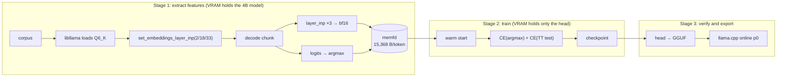

# AGENTS.md — spark-eagle3-forge

Retrain the EAGLE-3 draft head for Spark-X2.6-4B (FIT-Q6_K abliterated). The goal is a higher
draft acceptance rate in the **Chinese + thinking** register, so speculative decoding speeds up
single-sequence decode.

The upstream public head `VitreousCut/Spark-X2.6-4B-EAGLE3` (v8) only reaches p0 0.01–0.33 in
Chinese, against 0.46–0.92 in the author's English setup, so its payoff is unstable. That gap is
what this project is about.

> **Documentation layout**
> - This file: purpose, design, plan, **commands that actually work**, caveats. Published with the repo.
> - `docs/facts.md`: core facts (model geometry, cost model, vocabulary ceiling, llama.cpp changes).
>   §2 below is only an index.
> - `docs/notes.md`: measurements, derivations, failed attempts (portable, published).
> - `AGENTS.local.md`: hardware, absolute paths, environment versions, raw t/s (**gitignored**,
>   template in `.example`).

## 0. Where we are

G0, G1 and G2 pass, and S2a has run: 8M unique tokens over 8000 steps.
**`checkpoints/s2a.pt` / `spark-eagle3-s2a.gguf` replace v8 on Chinese workloads** — mean p0 over
the eight realistic Chinese prompts 0.148 → 0.316 offline and 0.148 → 0.348 through llama.cpp, with
a measured 1.19x decode speed-up on the same mix. `chat_think` misses G4 by 0.002 (0.3281 vs 0.33)
and the two English-heavy registers lose about 0.03. Gates in §8, stages in §11, evidence in
`docs/notes.md` §6 (protocol, fixed before the run) and §7 (run and results).

D0 (2026-10-30) measured the deployment sampler: the target's top-1 ceiling is 0.80 at temp 1.0
(0.88 at 0.6), the head converts about a third of it (0.29), and probabilistic drafting is still
identical to greedy. The head, not the temperature, is the next target; see `docs/notes.md` §8.

D1 measured the NLP mix (translation, summarisation, organisation, chat): overall p0 0.344 at a
0.869 ceiling, strongest on Chinese → English (0.449) and organisation (0.421), weakest on
summarisation (0.277–0.333). The English-heavy registers are coverage-capped at 0.81–0.89, so a
48K bilingual vocabulary is the next step; see `docs/notes.md` §9.

D2 built that vocabulary: 32K base + 16K English, warm-started from S2a. On held-out steps it
lifts coverage 0.939 → 0.971 overall and 0.684 → 0.960 on English text, and the 48K head loads in
llama.cpp. S2b/S3 use `d2t_v2_48k.i32` and `head_init_48k.pt`; see `docs/notes.md` §10.

## 1. Hard constraints (non-negotiable)

Every approach must satisfy all of these:

1. **Do not reduce KV precision** (keep f16)
2. **Do not shrink the context** (keep 131072)
3. **Do not reduce quantisation precision** (keep Q6_K)
4. **Keep training features in memory; do not rewrite NVMe**
5. **Write `AGENTS.md`, everything under `docs/`, and all code comments in English.**
   Test data and prompts may stay Chinese where the language itself is the subject.

Constraints 1–3 rule out narrower KV, shorter context and Q4, which leaves one lever:
**verify multiple tokens per forward pass** (speculative decoding).

## 2. Core facts

Derivations and measurements live in [`docs/facts.md`](docs/facts.md). Index only:

- [2.1 Model and runtime](docs/facts.md#21-model-and-runtime) —
  depth, width, RoPE, tied embedding, and the four constraints a 12 GiB single machine imposes
- [2.2 Cost model](docs/facts.md#22-cost-model-the-core-formula) —
  $\text{speed-up}=(1+p_0)/1.12$, break-even 0.12, `n-max` must be 1, the training target must be
  the target model's argmax
- [2.3 The hard ceiling on p0](docs/facts.md#23-the-hard-ceiling-on-p0-a-32k-draft-vocabulary) —
  $p_0 \le$ coverage, v8's vocabulary is almost entirely ASCII, rebuilding takes it 0.245 → 0.939
- [2.4 llama.cpp changes required](docs/facts.md#24-llama.cpp-changes-required) —
  the `t_layer_inp` patch, a private header, and why the shim must be C++

## 3. Design decisions

| Decision | Choice | Reason |
|---|---|---|
| Feature source | **llama.cpp (the Q6_K weights)** | Same weights as deployment, so train and deploy see identical features; no 8.2 GB download and no fused-qkv surgery |
| Training framework | Plain PyTorch (hand-written single decoder layer) | 218M parameters; no exposure to transformers version churn |
| Training target | CE against the **target's argmax** | The runtime only ever proposes an argmax; the author measured relabelling taking acceptance 0.49 → 0.81 |
| Second loss term | Training-time test (feed the draft its own output) | The author measured p0 0.50 → 0.70 |
| Feature precision | bf16 (llama.cpp gives F32; round-to-nearest-even before storing) | Doubles capacity. **v8's weights are F32**, so bf16 is our trade-off, not an inheritance; the evaluator must round the same way |
| Feature storage | **memfd + mmap** | Pure RAM, no tmpfs quota, no NVMe writes, no root |
| Starting point | v8 warm start, **`lm_head` retrained** | Only 4,243 of 32,000 rows overlap; the rest are re-initialised |
| Segmentation | extract → train → checkpoint immediately, per segment | Features live in RAM; a dead process loses them |

### Memory budget (training)

| Item | Size |
|---|---:|
| head fp32 parameters + gradients | 1.75 GB |
| AdamW moments | 1.75 GB |
| target `token_embd` (bf16) | 671 MB |
| Python + torch + CUDA host | ~2.5 GB |
| pinned staging / fragmentation headroom | ~3.5 GB |
| **Fixed overhead** | **~10 GiB** |

## 4. Architecture



Stages 1 and 2 **cannot** run at the same time.

### Feature format (settled)

A fixed **15,368 B** per token, mmap'd as a struct array:

| offset | type | contents |
|---:|---|---|
| 0 | bf16[3][2560] | **input** hidden state of layers 2 / 18 / 33 at position `p` |
| 15360 | int32 | `token[p+1]` (embedding lookup, **shift-left**) |
| 15364 | int32 | `argmax[p+1]` (training label) |

The runtime draft at position P consumes `(token[P+1], g_embd[P])`
(`common/speculative.cpp:747`), so storing the same-position token teaches the head a shifted
target — and that only surfaces at G1.

Capacity: 8 GiB ≈ 559K tokens, 32 GiB ≈ 2.24M, **40 GiB ≈ 2.79M**; 22M tokens needs 338 GB.

## 5. Directory layout

```
spark-eagle3-forge/
├── csrc/
│   ├── CMakeLists.txt         # -DLLAMACPP_ROOT=…
│   ├── spark_feat.cpp         # C++ shim: feature extraction, pure C ABI outward
│   ├── sp_feat_cli.cpp        # G0 harness: extract, print JSON, report coverage
│   └── sp_gen_cli.cpp         # coverage probe: generate with the chat template, count hits
├── spark_eagle3/
│   ├── llamacpp.py            # ctypes binding (tokenize / decode / features / argmax)
│   ├── feats.py               # memfd feature buffer, up-front capacity check
│   ├── corpus.py              # COIG / firefly / wikipedia / plain-text readers
│   ├── extract.py             # stage 1: corpus → memfd shard
│   ├── model.py               # EAGLE-3 head (v8 parameter names)
│   ├── eval_p0.py             # offline p0 replay (v8 dir, safetensors or a .pt checkpoint)
│   ├── train.py               # stage 2: extract → train → checkpoint, per segment
│   └── export_gguf.py         # head → GGUF for llama.cpp's draft-eagle3 loader
├── scripts/
│   ├── fetch_corpora.sh       # download corpora into datasets/raw/
│   ├── build_vocab.py         # build a candidate d2t from token frequency
│   ├── eval_vocab.py          # score a candidate vocabulary on recorded steps
│   ├── init_head.py           # v8 → warm-start checkpoint aligned to the new vocabulary
│   ├── make_prompts.py        # render probes with the model's own chat template
│   ├── g1_online.py           # online p0 through llama-server
│   ├── d0_matrix.py           # D0: temperature × sampling × register acceptance
│   ├── d0_report.py           # D0: aggregate the matrix into tables
│   ├── record_steps.py        # record greedy steps for vocabulary scoring
│   ├── build_union_vocab.py   # 48K union: keep the base ids, append English ids
│   ├── check_public.sh        # leak check (also installed as a pre-commit hook)
│   └── install_hooks.sh       # install that hook locally
├── configs/                   # reserved for stage configs; currently empty
├── .vscode/                   # settings.json (compile_commands.json) + tasks.json
├── datasets/  checkpoints/  logs/     # all gitignored
├── AGENTS.md                  # this file
├── AGENTS.local.md.example    # template for the gitignored machine-specific file
├── CLAUDE.md                  # points at AGENTS.md
├── README.md                  # English, the public front page
├── README.cn.md               # 简体中文
├── THIRD-PARTY-NOTICES.md     # upstream model / dataset / framework licences
└── docs/
    ├── facts.md               # core facts (§2 of this file expands here)
    └── notes.md               # measurements, derivations, open questions
```

## 6. Commands (verified)

All commands run from the repo root. Two environment variables must be set first (see §7):

```bash
export LLAMACPP_ROOT=…      # llama.cpp checkout carrying the spark2_5 patch
export MODELS_DIR=…         # holds <target>.gguf and spark-eagle3-v8.gguf
```

Python is the environment linked as `.venv` in the repo root (torch / safetensors / gguf).
Call it explicitly so a different interpreter does not get picked up:

```bash
.venv/bin/python -m spark_eagle3.extract …
```

Anything that loads the shim also needs:

```bash
export LD_LIBRARY_PATH="$LLAMACPP_ROOT/build/bin:$LD_LIBRARY_PATH"
export PYTHONPATH=.
```

### Build once

```bash
# Build the shim (also emits compile_commands.json for the editor)
cmake -S csrc -B csrc/build -G Ninja -DLLAMACPP_ROOT="$LLAMACPP_ROOT"
cmake --build csrc/build
```

### Setup steps already done (re-run only if an input changes)

```bash
# Render probes with the model's own chat template; without it the target goes off-distribution
.venv/bin/python scripts/make_prompts.py --model "$MODELS_DIR/<target>.gguf" \
    --out-dir datasets/prompts/rendered --set realistic

# Coverage: generate and count how often the draft vocabulary would hit
csrc/build/sp_gen_cli --model "$MODELS_DIR/<target>.gguf" \
    --d2t datasets/v8/d2t_target_ids.i32 \
    --prompt-file datasets/prompts/rendered/zh_tech.txt \
    --n-gen 256 --temp 0.7 --out-dir logs/cov

# Rebuild the vocabulary (equal character budget per domain) and score it
.venv/bin/python scripts/build_vocab.py --model "$MODELS_DIR/<target>.gguf" \
    --out datasets/vocab/d2t_v1_32k --vocab-size 32000 --chars-per-domain 40000000 \
    --code-dir "$LLAMACPP_ROOT/src"
.venv/bin/python scripts/eval_vocab.py logs/real/steps.i32 \
    datasets/v8/d2t_target_ids.i32 datasets/vocab/d2t_v1_32k.i32

# Warm-start checkpoint aligned to the new vocabulary
.venv/bin/python scripts/init_head.py --v8-dir datasets/v8 \
    --d2t datasets/vocab/d2t_v1_32k.i32 --out checkpoints/head_init.pt
```

### The regular cycle

```bash
# G0: feature self-consistency (no training needed)
csrc/build/sp_feat_cli --model "$MODELS_DIR/<target>.gguf" \
    --text AGENTS.md --ctx 1024 --tokens 512 --layers 0,2,18,33 --add-bos

# Stage 1: extract features
.venv/bin/python -m spark_eagle3.extract --model "$MODELS_DIR/<target>.gguf" \
    --max-tokens 32768 --chunk 2048 --d2t datasets/vocab/d2t_v1_32k.i32 \
    --out logs/shards/s1.json --text AGENTS.md \
    --coig datasets/raw/coig_cqia/COIG-CQIA-full.jsonl

# Stage 2: extract + train + checkpoint, eight segments = 8M unique tokens, 8000 steps
.venv/bin/python -m spark_eagle3.train --model "$MODELS_DIR/<target>.gguf" \
    --d2t datasets/vocab/d2t_v1_32k.i32 --init checkpoints/head_init.pt \
    --out checkpoints/s2a --steps 8000 --segments 8 --tokens-per-segment 1000000 \
    --seq-len 1024 --batch-seqs 2 --lr 1e-4 --lambda-ttt 0.5 --grad-clip 1.0 \
    --ckpt-every 500 --log-every 20 --val-chunk-every 25 \
    --coig datasets/raw/coig_cqia/COIG-CQIA-full.jsonl \
    --firefly datasets/raw/firefly/firefly-train-1.1M.jsonl \
    --wiki datasets/raw/wikipedia_zh/train-00000-of-00006.parquet \
    --code-dir "$LLAMACPP_ROOT/src" --log logs/train_s2a.jsonl

# Stage 3: offline p0 (v8 for the reference table; `--head checkpoints/s2a.pt` for a trained one)
.venv/bin/python -m spark_eagle3.eval_p0 --model "$MODELS_DIR/<target>.gguf" \
    --head datasets/v8 --dtype bfloat16 --n-gen 256 \
    --prompt-file datasets/prompts/rendered/zh_tech.txt --out logs/p0.json

# Stage 3: export to GGUF (G2); the tokenizer is copied from an existing head GGUF
.venv/bin/python -m spark_eagle3.export_gguf --ckpt checkpoints/s2a.pt \
    --out "$MODELS_DIR/spark-eagle3-s2a.gguf" \
    --tokenizer-from "$MODELS_DIR/spark-eagle3-v8.gguf"

# Stage 3: online p0 (llama-server's draft acceptance is p0)
.venv/bin/python scripts/g1_online.py \
    --server "$LLAMACPP_ROOT/build/bin/llama-server" \
    --model "$MODELS_DIR/<target>.gguf" --head "$MODELS_DIR/spark-eagle3-v8.gguf" \
    --prompt-file datasets/prompts/rendered/zh_tech.txt \
    --n-predict 128 --out logs/g1_online.json --server-log logs/g1_server.log

# D0: deployment-matched acceptance (baseline ceiling, greedy, probabilistic);
# one server per mode, resumable, writes one JSON line per request.
# add --extra-arg=--no-spec-draft-backend-sampling to make probabilistic sample
.venv/bin/python scripts/make_prompts.py --model "$MODELS_DIR/<target>.gguf" \
    --out-dir datasets/prompts/daily --set daily
.venv/bin/python scripts/d0_matrix.py \
    --server "$LLAMACPP_ROOT/build/bin/llama-server" \
    --model "$MODELS_DIR/<target>.gguf" --head "$MODELS_DIR/spark-eagle3-s2a.gguf" \
    --prompt-dir datasets/prompts/daily \
    --out logs/d0_requests.jsonl --log-dir logs/d0
.venv/bin/python scripts/d0_report.py --requests logs/d0_requests.jsonl \
    --out-md logs/d0_report.md --out-json logs/d0_report.json
# D1: same commands with --set nlp, --prompt-dir datasets/prompts/nlp, --temps 1.0

# D2: 48K union vocabulary and the S2a warm start
.venv/bin/python scripts/record_steps.py --model "$MODELS_DIR/<target>.gguf" \
    --prompt-dir datasets/prompts/nlp --out logs/nlp/steps.i32
.venv/bin/python scripts/build_union_vocab.py --model "$MODELS_DIR/<target>.gguf" \
    --base datasets/vocab/d2t_v1_32k.i32 --out datasets/vocab/d2t_v2_48k
.venv/bin/python scripts/init_head.py --from-checkpoint checkpoints/s2a.pt \
    --d2t datasets/vocab/d2t_v2_48k.i32 --out checkpoints/head_init_48k.pt
```

### What "verified" means here

There is **no test suite, no linter and no formatter** in this repo. Correctness is established by
the G0 and G1 commands above: G0 proves the feature layout and the bf16 cast, G1 proves the offline
replay reproduces llama.cpp's own draft acceptance. G2 adds a round-trip check inside the exporter
(every tensor and `d2t` compared against the checkpoint), and G3–G4 are p0 measurements on protocol
P. Do not introduce a pytest scaffold; add a gate instead.

Committing runs `scripts/check_public.sh` as a pre-commit hook, so a commit can fail for a reason
that has nothing to do with the code — see §12.

## 7. External dependencies

The repo records **no absolute paths**; every location comes from an environment variable
(actual values in `AGENTS.local.md`):

| Variable | Purpose |
|---|---|
| `LLAMACPP_ROOT` | llama.cpp checkout (`build/bin/llama` present, `spark2_5` patched) |
| `MODELS_DIR` | holds the target Q6_K GGUF and `spark-eagle3-v8.gguf` |
| `SPARK_START` | script that launches llama-server |
| `PYTHON_ENV` | Python environment with torch / safetensors / gguf (the repo-root `.venv` symlink points at it) |

`<target>.gguf` in the commands below means whichever Q6_K build of Spark lives in `MODELS_DIR`.

Runtime flags: `-c 131072 -ctk f16 -ctv f16 -ngl 99 -fa on --parallel 1`.

Already downloaded (all under the gitignored `datasets/`):

| Item | Size | Status |
|---|---:|---|
| `v8/model.safetensors` + `config.json` + `train_log.json` | 874 MB | ✅ sha256 verified |
| Upstream `llama.cpp-spark2_5-layer-inputs.patch` and model card | 8 KB | ✅ downloaded |
| COIG-CQIA / firefly-train-1.1M / zh-wikipedia (1 shard) | 1.9 GB | ✅ sha256 verified |

`Chinese-FineWeb-Edu` and `CCI3-Data` need login (401 / gated), so they are unused.

## 8. Gates (hard stops)

All p0 numbers are on **protocol P** (`docs/notes.md` §6): `eval_p0.py --dtype bfloat16 --n-gen 256`,
greedy, on prompts rendered with the model's own chat template. That protocol and its v8 baseline
were written down before S2a started, because §8 used to quote temp-1.0 figures that `eval_p0.py`
never measures.

| Gate | Condition | Status |
|---|---|---|
| ~~G0 feature self-consistency~~ | `layer_inp[0]` == token embedding row | ✅ 3e-4 |
| ~~G1 offline ≈ online~~ | the two p0 values differ by **< 0.03** | ✅ 0.014 (v8), 0.032 (S2a) |
| ~~G2 exportable~~ | the trained head converts to GGUF and loads without an assert | ✅ 422 MB, round-trip exact |
| ~~G3 probe~~ | `chat_think` p0 **≥ 0.25** (v8 was 0.2461) | ✅ **0.3281** |
| ~~G3b no forgetting~~ | `code` **≥ 0.18** and `copy` **≥ 0.13** (v8 0.1992 / 0.1562) | ✅ 0.2070 / 0.2031 |
| ~~G3c the point~~ | realistic mean p0 **≥ 0.25** (v8 was 0.1480) | ✅ **0.3159** |
| **G4 ship** | `chat_think` p0 ≥ **0.33** (→ 1.19x) | ❌ **0.3281**, short by 0.002 |

G4 is recorded as **missed**: the threshold was fixed in advance and the head reaches 1.186x, not
1.19x. The realistic mean (0.3159 offline, 0.3480 online) and the measured 1.19x wall clock say the
head is worth shipping for Chinese work anyway, which is a decision for the user, not a re-scored
gate.

p0 noise is about ±0.03; do not read anything smaller as a signal.

## 9. Risks and pitfalls

| Risk | Mitigation |
|---|---|
| Oversized memfd → OOM killer takes the process silently | check capacity before writing; checkpoint after every segment |
| Desktop competing for RAM / VRAM | close browsers and move the desktop to the iGPU before training |
| `llama-ext.h` is private and C++-linked | compile the shim as C++ and declare the prototypes by hand; never guess struct layout with ctypes |
| The vocabulary caps p0 ([facts.md §2.3](docs/facts.md#23-the-hard-ceiling-on-p0-a-32k-draft-vocabulary)) | measure per-register coverage before training; change the vocabulary first if it is short |
| F32 → bf16 feature rounding | the evaluator must round identically so train and eval agree |
| Unusual RoPE geometry (64 dims global / 256 swa) | let llama.cpp compute positions; never replicate it in Python |
| Chunk boundaries | decode one extra token per chunk so the shifted label exists; clear the KV cache between chunks |
| `sp_decode()` writes `take + 1` rows per chunk | reserve `take + 1` rows or the last chunk of a segment walks off the mmap (SIGSEGV) |
| Target (6 GiB) and head + AdamW state (4 GiB) cannot share a 12 GiB card | park the head and optimiser on the CPU while extracting, reload after |
| Labels outside the draft vocabulary | mask them in the CE (`ignore_index`); never map them to an arbitrary id |
| Export conventions are invisible in the tensor names | `d2t` is stored **absolute** (the safetensors is delta-encoded) and `attn_q`/`attn_k` are **rope-permuted**; `export_gguf.py` compares both back against the checkpoint |
| `eagle3.block_count` must be 1 | the loader builds exactly one layer, so any other value orphans tensors |
| Editor cannot find `llama.h` | CMake exports `compile_commands.json`; `.vscode/settings.json` points at it |

## 10. Do not

- ❌ `git push`; commit cleanly and let the user review and push
- ❌ modify the `master` branch of `$LLAMACPP_ROOT` (keep changes on a local branch)
- ❌ use `pkill -f <vague pattern>`; use a full path
- ❌ lower KV precision / shrink the context / lower quantisation precision (§1)
- ❌ train the `spark2_5` MTP graph (EAGLE-3 already has weights and runtime support)
- ❌ let feature capacity approach the RAM ceiling (subtract the ~10 GiB training overhead first)

## 11. Milestones

| Stage | Content | Status |
|---|---|---|
| S1 | End-to-end extraction + G1 | ✅ |
| **S2a** | 8M unique tokens (public corpora) + 8k steps + G3/G3b/G3c | ✅ G4 missed by 0.002 |
| **D0** | Deployment-matched temperature × sampling matrix | ✅ ceiling 0.80, head 0.29 |
| **D1** | NLP register matrix (translation, summary, organisation, chat) | ✅ p0 0.344, English coverage 0.81–0.89 |
| **D2** | 48K bilingual union vocabulary + S2a warm start | ✅ held-out coverage 0.971 |
| S2b | NLP mixture + long-context shards, 48K head (4M recipe check) | open |
| S3 | Scale to 12–16M tokens with the S2b mixture | final head |

### S2a, as it ran

1. **Extract**: four domains mixed by token quota (COIG 35% / firefly 35% / zh-wikipedia 20% /
   llama.cpp `src` 10%), chunk 2048, one ~10 GiB memfd segment at a time — never the 40 GiB budget,
   because the 40 GiB figure predates the ~10 GiB training overhead and the machine has no swap
2. **`train.py`**: warm start from `checkpoints/head_init.pt`;
   loss = `CE(draft_logits, d2t_index(argmax))` + 0.5 · `CE(training-time test)`;
   positions whose label is outside the vocabulary use `ignore_index`
3. **Hyperparameters**: 8k steps, AdamW, lr 1e-4 cosine to 10%, bf16 autocast, grad clip 1.0,
   2 × 1024-token sequences per step
4. **Checkpoint** every 500 steps (features are in RAM; a dead process loses them)
5. **Acceptance**: `chat_think` 0.3281, `code` 0.2070, `copy` 0.2031, realistic mean 0.3159
   (`docs/notes.md` §7d)

Two recipe changes from the plan above, both recorded before the run finished: the corpus is 8M
tokens over eight segments rather than 2.79M over one 40 GiB buffer (RAM safety), and the gate
targets moved to protocol P (`docs/notes.md` §6) because the old ones quoted the temp-1.0 table.

## 12. Before publishing (read before writing any file)

This repo is public. **Being documentation is not an exemption**: `AGENTS.md`, `docs/facts.md`,
`docs/notes.md` and every code comment are published verbatim, and prose is the easiest place to
leak. Treat a comment or a note exactly like a commit message.

### Never write these into any tracked file

| Leak | Examples that must not appear in a tracked file |
|---|---|
| Absolute paths | any path rooted at a home directory, a mount point or a drive letter |
| Environment names | a conda/venv name, or the target of a `.venv` symlink outside the repo |
| Identifiers | hostname, login name, e-mail address, `user@host` |
| Private / link-local IPs | `10.x`, `192.168.x`, `172.16-31.x`, `169.254.x` (loopback is harmless) |
| Hardware identity | GPU / CPU / disk model names, VRAM or RAM size, any serial-like string |
| Absolute performance | tokens/s, prefill rates, measured bandwidth |
| Local setup details | ports, the personal launch script, cache or session directories |
| Personal context | anything from a private conversation, dates tied to a person, quoted messages |

Those belong in `AGENTS.local.md` (gitignored); `AGENTS.local.md.example` shows the shape without
the values. Code reads them from `$ENV_VAR`, never from literals.

### Publishable

Model architecture, GGUF tensor layout, llama.cpp API behaviour, p0 / acceptance rates, relative
speed-ups, experimental conclusions, algorithm design — reproducible research results belong here.

### Checklist before every commit

```bash
scripts/check_public.sh       # scans tracked files; exit code 1 means findings
gitleaks git                  # use gitleaks to scan for information leaks
git diff --cached             # read it once against the table above
```

`check_public.sh` is also installed as a pre-commit hook by `scripts/install_hooks.sh`, so a commit
that trips it aborts and prints the offending file and pattern. Keywords the script cannot guess go
in the **untracked** `.check_public.extra`:
`EXTRA=( 'MyGpuModel' 'my-env-name' )`.

**When in doubt, leave it out.** A missing sentence costs one question; a leaked path costs a history rewrite.
