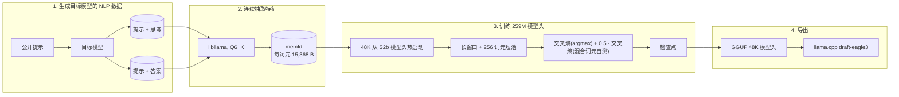

# spark-eagle3-forge

[English](README.md) | **简体中文**

为 Spark-X2.6-4B 重训 EAGLE-3 草稿头，让推测解码在真实工作负载（中英翻译、摘要、资料整理、聊天）上真正划算。公开的 v8 模型头用英文与代码文本训练，它的 32K 草稿词表只覆盖约一半 ASCII、1.1% 的 CJK；S2a → S2b → S3 三个阶段把同一套矩阵的平均值从 **0.344 升到 0.495**，48K 双语词表覆盖率 **0.979–0.995**，实测解码加速 **1.15–1.35 倍**。（v8 的 0.148 是另一套提示，见旧版说明。）

| | |
|---|---|
| 已发布模型头 | [`TiaoFeng/Spark-X2.6-4B-EAGLE3-Chinese-retrain`](https://huggingface.co/TiaoFeng/Spark-X2.6-4B-EAGLE3-Chinese-retrain) — `spark-eagle3-s3-48k-q8.gguf`（268 MiB） |
| 权重父模型 | 该仓库 `legacy/` 里的 S2b 与 S2a 模型头；S2a 又是从 `VitreousCut/Spark-X2.6-4B-EAGLE3` 热启动重训的 |
| 目标模型 | Spark-X2.6-4B，Q6_K |

## 结果

NLP 矩阵：48 题、7 个工作负载、目标温度 1.0、草稿头贪心解码、走 `llama-server`、`--spec-draft-n-max 1`。p0 是第一个草稿词元被接受的比例。

| 工作负载 | S2a (32K) | S2b (48K) | S3 (48K) |
|---|---:|---:|---:|
| 对话 | 0.276 | 0.304 | **0.380** |
| 中 → 英翻译 | 0.449 | 0.601 | **0.638** |
| 英 → 中翻译 | 0.325 | 0.480 | **0.530** |
| 中文摘要（中 → 中） | 0.333 | 0.469 | **0.479** |
| 英文摘要（英 → 中） | 0.277 | 0.424 | **0.453** |
| 资料整理 | 0.421 | 0.516 | **0.532** |
| 长上下文 | 0.298 | 0.395 | **0.419** |
| **全部** | **0.344** | **0.460** | **0.495** |

另有三个矩阵没覆盖的探针。前两个在 PyTorch 里离线重放同一组 48 题（贪心、128 词元）；第三个把同一份文档重复到各长度、只评 64 词元：

| 探针 | S2b | S3 |
|---|---:|---:|
| p0，48 题矩阵离线重放 | 0.457 | **0.502** |
| 答案段（同一组提示改为不思考） | 0.385 | **0.462** |
| p0 在 2k / 8k / 16k / 32k 会话上下文 | 0.484 / 0.406 / 0.281 / 0.219 | **0.594 / 0.422 / 0.375 / 0.250** |

- 目标模型 top-1 的词表覆盖率：**0.979–0.995**（48K），32K 是 0.81–0.98。
- 模型头利用了目标模型 top-1 概率的 **0.570**（S2b：0.529）。
- 离线重放是对每个生成位置与目标模型取最大值的词元（argmax）比对，而 llama.cpp 统计的是每个验证步被接受的草稿；同一组 48 题、**目标温度为 0 的贪心解码**下两者分别是 **0.502 与 0.549**（都是按验证步加权），即重放在贪心下低 0.047。部署矩阵是另一个协议（温度 1.0），读数是 0.495。
- 解码在**每个测过的长度都是 1.15–1.35 倍**，包含 13–14k 上下文。模型头唯一的成本是预填充：加 `-md` 后草稿头也会处理提示，14k 时提示处理约慢 28%、短上下文只慢几个百分点。那是每请求一次的固定成本，会随响应长度摊薄（13–14k：128 词元响应 0.92 倍，512 词元响应 1.06 倍）。

更早的 v8 → S2a 对比（8 个中文提示离线 0.148 → 0.316；5 题在线 A/B 0.148 → 0.348、1.19 倍）见旧版说明（`legacy/README.md`）；那是另一套提示，不能与上表直接比较。

## 词表天花板

草稿头只输出自己的草稿词表，再通过 `d2t` 散射回目标模型 131,072 词元的词表；集合外全部 −∞，所以

$$p_0 \le \text{覆盖率} = \Pr[\text{目标模型 argmax} \in \text{草稿词表}].$$

v8 的 32K 词表看起来是某一个英文/代码语料的切片：在录制的负载上只覆盖 1.1% 的 CJK 词元、49.9% 的 ASCII 词元，上限 0.245。第一阶段（S2a）用中文数据重挑 32K 槽位，覆盖率达到 0.939，D1 平均 p0 0.344。第二阶段（S2b）保留这 32K，再追加 16K 英文/ASCII 词元（来自一个英文维基百科分片与录制的 NLP 步骤）：覆盖率 0.979–0.995，D1 平均 p0 0.460。S3 沿用同一个词表，所以剩下的差距是模型头质量，不是覆盖率。

## S3 改了什么

- **答案段。** S2b 的响应文本只有 0.46% 是答案——3,520 笔中有 128 笔在预算内结束思考并带一小段答案——所以该阶段基本未被训练：128 词元下 0.385，思考段 900 词元是 0.493。S3 用关闭思考的同一批任务生成 403 万词元并训练；每个工作负载都提升，资料整理在该探针上 +0.106。
- **短文档。** 窗口采样器原本会丢掉所有短于 `seq_len + 1` 行的文档——那正好是短答案的形状。现在有第二个互斥的 256 词元窗口池来训练它们；对话在矩阵上 +0.076（离线探针 +0.086），是所有工作负载里最多的。
- **长上下文。** 连续的长文记录被并成约 29k 词元的文档，让模型头看到超过 16k 抽取窗口的上下文：16k 的 p0 从 0.281 升到 0.375。
- **数据**：777 万训练行，取自目标模型自己生成的 889 万词元（486 万思考段 + 403 万答案段）。公开文本只出现在提示里；训练目标永远是模型自己的输出。
- **训练**：4 段、每段约 194 万行，共 4,000 步（每步 2,048 词元）；最终训练交叉熵 1.94、top-1 0.673。

S2b 的贡献没有变、仍是基础：346 万行思考段、连续抽取（2k 子批次不重置 KV 缓存）、交叉熵(argmax) + 0.5 × 混合词元训练期自测的损失。

## 流程



特征直接来自 **llama.cpp 实际运行的量化 Q6_K GGUF**，由 C++ shim 写进 `os.memfd_create` 映射（不写 NVMe、不占 tmpfs、不需要管理员权限），抽取和训练轮流用一张消费级显卡。完整设计见 `AGENTS.md` 与 `docs/facts.md`。

## 快速开始

发布文件是 `spark-eagle3-s3-48k-q8.gguf`，48K `d2t` 已嵌在 GGUF 里。`datasets/`、`checkpoints/`、`logs/` 都在 `.gitignore`，全新克隆需要先生成。常规流程见 [`AGENTS.md`](AGENTS.md) §6，简短版：

```bash
export LLAMACPP_ROOT=…   # 带 spark2_5 layer-input 补丁的 llama.cpp
export MODELS_DIR=…      # 目标 Q6_K GGUF 与发布模型头

cmake -S csrc -B csrc/build -G Ninja -DLLAMACPP_ROOT="$LLAMACPP_ROOT" && cmake --build csrc/build

# 48K 词表 + 从 S2a 检查点热启动（历史：S2a -> S2b）
.venv/bin/python scripts/record_steps.py --model "$MODELS_DIR/<target>.gguf" \
    --prompt-dir datasets/prompts/nlp --out logs/nlp/steps.i32
.venv/bin/python scripts/build_union_vocab.py --model "$MODELS_DIR/<target>.gguf" \
    --base datasets/vocab/d2t_v1_32k.i32 --out datasets/vocab/d2t_v2_48k
.venv/bin/python scripts/init_head.py --from-checkpoint checkpoints/s2a.pt \
    --d2t datasets/vocab/d2t_v2_48k.i32 --out checkpoints/head_init_48k.pt

# 生成两种通道，再从 S2b 模型头训练 S3
.venv/bin/python scripts/gen_nlp_data.py --server "$LLAMACPP_ROOT/build/bin/llama-server" \
    --model "$MODELS_DIR/<target>.gguf" --out-dir datasets/nlp
.venv/bin/python scripts/gen_nlp_data.py --server "$LLAMACPP_ROOT/build/bin/llama-server" \
    --model "$MODELS_DIR/<target>.gguf" --out-dir datasets/nlp_answer \
    --think-off --n-predict 512 --long-n-predict 640
.venv/bin/python scripts/train_s2b.py --model "$MODELS_DIR/<target>.gguf" \
    --d2t datasets/vocab/d2t_v2_48k.i32 --init checkpoints/s2b.pt \
    --out checkpoints/s3 --steps 4000 --segments 4 --tokens-per-segment 2300000 \
    --weights sum=0.09,trans=0.17,org=0.06,chat=0.09,long=0.09 \
    --answer-dir datasets/nlp_answer \
    --answer-weights sum=0.06,trans=0.15,org=0.05,chat=0.06,long=0.09 \
    --short-seq-len 256 --short-mix 0.25 --chars-per-token 2.2 \
    --long-concat-chars 64000 --n-ctx 32768

# 导出、量化、启动
.venv/bin/python -m spark_eagle3.export_gguf --ckpt checkpoints/s3.pt \
    --out "$MODELS_DIR/spark-eagle3-s3-48k.gguf" --name spark-eagle3-s3-48k \
    --tokenizer-from "$MODELS_DIR/spark-eagle3-v8.gguf"
scripts/quantize_head.sh checkpoints/s3.pt "$MODELS_DIR/spark-eagle3-s3-48k-q8.gguf"
llama-server -m "$MODELS_DIR/<target>.gguf" -md "$MODELS_DIR/spark-eagle3-s3-48k-q8.gguf" \
    --spec-type draft-eagle3 --spec-draft-n-max 1 \
    -c 131072 -ctk f16 -ctv f16 -ngl 99 --parallel 1 -fa on
```

## 已知问题

- **32k 上下文仍弱**（0.250，S2b 是 0.219）。A/B 只量到 13–14k，那里解码更快；32k 本身没有做 A/B，而且收益随上下文增长而缩小。
- **长上下文的提示与训练文本重叠。** 矩阵的长上下文题用本项目的 `docs/notes.md` 当上下文，而 `long` 任务的英文那一半也由同一个文件生成，所以那一行的 +0.024 偏乐观；独立证据是上下文探针（16k 提升 0.094），它的文本不属于任何一份生成训练文档，续写是合成的，只能用来看方向。
- **离线探针不等于运行时。** 它只重放生成的列，而 llama.cpp 的草稿解码器会处理每个已验证的词元（含整个提示），这个缺口随提示变长而变大。S2b 与 S3 在这类探针上可比（两边都少算），运行时数字看线上矩阵。
- **只有一个训练随机种子。** 整体提升远大于逐题 ±0.03 的噪声，但没有跑第二个种子。
- **128 词元响应下达不到 1.30 倍**（短上下文平均 1.19 倍、全部 48 题 1.11 倍）。这既是模型头的结论，也是响应长度的产物：解码是 1.15–1.35 倍，而预填充是每请求一次的固定成本。
- **词表有一部分是样本内选的**：16K 个英文/ASCII 词元的排序部分来自同一组 48 道题录制的步骤（权重 50），部分来自一个英文维基百科分片，覆盖率因此偏乐观；模型头没有在这些指令上训练过，但长上下文的上下文有重叠，见上一条。
- **只测了单序列**：`--parallel 1`；批量推理没有调优。
- **只适用于 Spark**：`spark2_5` 架构的 EAGLE-3 模型头，读取第 2/18/33 层。

## 许可证

**代码**：BSD 3-Clause，见 [`LICENSE`](LICENSE) —— Copyright (c) 2026, 條風。

**模型头**：Apache-2.0，`VitreousCut/Spark-X2.6-4B-EAGLE3` 经本仓库 S2a、S2b 模型头的衍生物；发布时的 NOTICE 列出修改。训练语料：COIG-CQIA、firefly-train-1.1M、wikipedia（中文与英文；英文分片另用于选词和生成提示）与目标模型生成的文本。详见 [`THIRD-PARTY-NOTICES.md`](THIRD-PARTY-NOTICES.md)。

## 声明

- 目标模型：[SC117/Spark-X2.6-4B-abliterated-FIT-GGUF](https://huggingface.co/SC117/Spark-X2.6-4B-abliterated-FIT-GGUF)（Q6_K），基于 [XHToken/Spark-X2.6-4B-Base](https://huggingface.co/XHToken/Spark-X2.6-4B-Base)。
- 草稿头：[VitreousCut/Spark-X2.6-4B-EAGLE3](https://huggingface.co/VitreousCut/Spark-X2.6-4B-EAGLE3) v8 → 本仓库 32K S2a → S2b → S3。
- 训练语料：[m-a-p/COIG-CQIA](https://huggingface.co/datasets/m-a-p/COIG-CQIA)、[YeungNLP/firefly-train-1.1M](https://huggingface.co/datasets/YeungNLP/firefly-train-1.1M)、[wikimedia/wikipedia](https://huggingface.co/datasets/wikimedia/wikipedia)。
- 推理：[ggml-org/llama.cpp](https://github.com/ggml-org/llama.cpp)；训练：[pytorch/pytorch](https://github.com/pytorch/pytorch) 等。

* 完整的第三方协议和版权声明请参阅 [THIRD-PARTY-NOTICES.md](THIRD-PARTY-NOTICES.md)。
