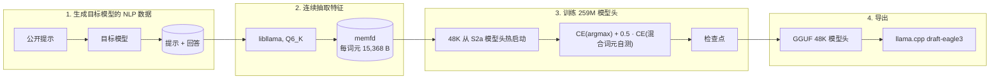

# spark-eagle3-forge

[English](README.md) | **简体中文**

为 Spark-X2.6-4B 重训 EAGLE-3 草稿头，让推测解码在真实工作负载（中英翻译、摘要、资料整理、聊天）上真正划算。公开的 v8 模型头偏向英文与代码文本；经过两个阶段的重训，同一套 48 题 NLP 矩阵上的平均草稿接受率从 **0.344 升到 0.460**，48K 双语词表覆盖率 **0.979–0.995**，估计解码加速 **1.30 倍**。

| | |
|---|---|
| 已发布模型头 | [`TiaoFeng/Spark-X2.6-4B-EAGLE3-Chinese-retrain`](https://huggingface.co/TiaoFeng/Spark-X2.6-4B-EAGLE3-Chinese-retrain) — `spark-eagle3-s2b-48k.gguf` |
| 权重父模型 | 该仓库 `legacy/` 里的 32K S2a 模型头；S2a 又是从 `VitreousCut/Spark-X2.6-4B-EAGLE3` 热启动重训的 |
| 目标模型 | Spark-X2.6-4B，Q6_K |

## 结果

NLP 矩阵：48 题、7 个工作负载、温度为 1.0、贪心解码、走 `llama-server`、`--spec-draft-n-max 1`。p0 是第一个草稿词元被接受的比例；验证前向约有 12% 固定开销，所以加速比 ≈ `(1 + p0) / 1.12`。

| 工作负载 | S2a (32K) | S2b (48K) | Δ |
|---|---:|---:|---:|
| 对话 | 0.276 | 0.304 | +0.028 |
| 中 → 英翻译 | 0.449 | **0.601** | +0.152 |
| 英 → 中翻译 | 0.325 | **0.480** | +0.155 |
| 中文摘要（中 → 中） | 0.333 | 0.469 | +0.136 |
| 英文摘要（英 → 中） | 0.277 | 0.424 | +0.147 |
| 资料整理 | 0.421 | 0.516 | +0.095 |
| 长上下文 | 0.298 | 0.395 | +0.097 |
| **全部** | **0.344** | **0.460** | **+0.116** |

- 目标模型 top-1 的词表覆盖率：**0.979–0.995**（48K），32K 是 0.81–0.98。
- 模型头利用了目标模型 top-1 概率的 **0.529**（S2a：0.396）。
- 估计加速：**1.30 倍**（S2a 1.20 倍）；S2b 的受控实际耗时 A/B 尚未做。

更早的 v8 → S2a 对比（8 个中文提示离线 0.148 → 0.316；5 题在线 A/B 0.148 → 0.348、1.19 倍）见 32K 旧版说明（`legacy/README.md`）；那是另一套提示，不能与上表直接比较。

## 词表天花板

草稿头只输出自己的草稿词表，再通过 `d2t` 散射回目标模型 131,072 词元的词表；集合外全部 −∞，所以

$$p_0 \le \text{覆盖率} = \Pr[\text{目标模型 argmax} \in \text{草稿词表}].$$

v8 的 32K 词表看起来是某一个英文/代码语料的切片：在录制的负载上只覆盖 1.1% 的 CJK 词元、49.9% 的 ASCII 词元，上限 0.245。第一阶段（S2a）用中文数据重挑 32K 槽位，覆盖率达到 0.939，D1 平均 p0 0.344。第二阶段（S2b）保留这 32K，再追加 16K 英文/ASCII 词元（来自一个英文维基百科分片与录制的 NLP 步骤）：覆盖率 0.979–0.995，D1 平均 p0 0.460。

## S2b 改了什么

- **数据**：训练用 346 万词元，取自目标模型自身生成的约 478 万词元——摘要、翻译、资料整理、聊天，外加长上下文文档。目标模型自己的输出就是训练分布；公开文本只作提示，不作训练目标。
- **特征**：连续抽取，2,048 词元的子批次、不重置 KV 缓存，最长 16k 上下文，所以生成位置的特征能看到完整文档前缀。
- **损失**：对目标模型 argmax 的交叉熵（CE）+ 0.5 × 混合词元训练期自测的交叉熵；每个位置以 0.5 的概率输入草稿自己的 argmax，否则输入目标词元。
- **词表**：48K 并集，从 S2a 模型头热启动；保留 32,000 行，新增 16,000 行英文/ASCII 词元。
- **训练**：4 段共 2,000 步（每段 500 步），每步 2 × 1,024 词元；最终训练 CE 2.015、top-1 0.657。

## 流程



特征直接来自 **llama.cpp 实际运行的量化 Q6_K GGUF**，由 C++ shim 写进 `os.memfd_create` 映射（不写 NVMe、不占 tmpfs、不需要 root），抽取和训练轮流用一张消费级显卡。完整设计见 `AGENTS.md` 与 `docs/facts.md`。

## 快速开始

发布文件是 `spark-eagle3-s2b-48k.gguf`，48K `d2t` 已嵌在 GGUF 里。`datasets/`、`checkpoints/`、`logs/` 都在 `.gitignore`，全新克隆需要先生成。完整命令见 [`AGENTS.md`](AGENTS.md) §6，简短版：

```bash
export LLAMACPP_ROOT=…   # 带 spark2_5 layer-input 补丁的 llama.cpp
export MODELS_DIR=…      # 目标 Q6_K GGUF 与 v8 模型头

cmake -S csrc -B csrc/build -G Ninja -DLLAMACPP_ROOT="$LLAMACPP_ROOT" && cmake --build csrc/build

# 48K 词表 + 从 S2a 检查点热启动
.venv/bin/python scripts/record_steps.py --model "$MODELS_DIR/<target>.gguf" \
    --prompt-dir datasets/prompts/nlp --out logs/nlp/steps.i32
.venv/bin/python scripts/build_union_vocab.py --model "$MODELS_DIR/<target>.gguf" \
    --base datasets/vocab/d2t_v1_32k.i32 --out datasets/vocab/d2t_v2_48k
.venv/bin/python scripts/init_head.py --from-checkpoint checkpoints/s2a.pt \
    --d2t datasets/vocab/d2t_v2_48k.i32 --out checkpoints/head_init_48k.pt

# 生成 NLP 语料并训练
.venv/bin/python scripts/gen_nlp_data.py --server "$LLAMACPP_ROOT/build/bin/llama-server" \
    --model "$MODELS_DIR/<target>.gguf" --out-dir datasets/nlp
.venv/bin/python scripts/train_s2b.py --model "$MODELS_DIR/<target>.gguf" \
    --d2t datasets/vocab/d2t_v2_48k.i32 --init checkpoints/head_init_48k.pt \
    --out checkpoints/s2b --steps 2000 --segments 4

# 导出与启动
.venv/bin/python -m spark_eagle3.export_gguf --ckpt checkpoints/s2b.pt \
    --out "$MODELS_DIR/spark-eagle3-s2b-48k.gguf" --tokenizer-from "$MODELS_DIR/spark-eagle3-s2a.gguf"
llama-server -m "$MODELS_DIR/<target>.gguf" -md "$MODELS_DIR/spark-eagle3-s2b-48k.gguf" \
    --spec-type draft-eagle3 --spec-draft-n-max 1 \
    -c 131072 -ctk f16 -ctv f16 -ngl 99 --parallel 1 -fa on
```

## 已知问题

- **答案阶段尚未训练。** 每个生成的回答都在思考段内撞到 `n_predict` 上限；D1 门槛只评前 128 个词元（同一思考段），思考段之后的长回答不在评测范围内。
- **聊天提升最小**（+0.028）；聊天文档长度接近 1,024 词元的窗口，很多窗口放不下，被采样器跳过。
- **1.30 倍是接受率估算。**
- **词表有一部分是样本内选的**：16K 个英文/ASCII 词元的排序部分来自同一组 48 道题录制的步骤（权重 50），部分来自一个英文维基百科分片，覆盖率因此偏乐观；模型头本身没有在这些提示上训练过。
- **只测了单序列**：`--parallel 1`；批量推理没有调优。
- **只适用于 Spark**：`spark2_5` 架构的 EAGLE-3 模型头，读取第 2/18/33 层。

## 许可证

**代码**：BSD 3-Clause，见 [`LICENSE`](LICENSE) —— Copyright (c) 2026, 條風。

**模型头**：Apache-2.0，`VitreousCut/Spark-X2.6-4B-EAGLE3` 经本仓库 S2a 模型头的衍生物；发布时的 NOTICE 列出修改。训练语料：COIG-CQIA、firefly-train-1.1M、wikipedia（中文与英文；英文分片另用于选词和 S2b 生成提示）与目标模型生成的文本。详见 [`THIRD-PARTY-NOTICES.md`](THIRD-PARTY-NOTICES.md)。

## 声明

- 目标模型：[SC117/Spark-X2.6-4B-abliterated-FIT-GGUF](https://huggingface.co/SC117/Spark-X2.6-4B-abliterated-FIT-GGUF)（Q6_K），基于 [XHToken/Spark-X2.6-4B-Base](https://huggingface.co/XHToken/Spark-X2.6-4B-Base)。
- 草稿头：[VitreousCut/Spark-X2.6-4B-EAGLE3](https://huggingface.co/VitreousCut/Spark-X2.6-4B-EAGLE3) v8 → 本仓库 32K S2a → S2b。
- 训练语料：[m-a-p/COIG-CQIA](https://huggingface.co/datasets/m-a-p/COIG-CQIA)、[YeungNLP/firefly-train-1.1M](https://huggingface.co/datasets/YeungNLP/firefly-train-1.1M)、[wikimedia/wikipedia](https://huggingface.co/datasets/wikimedia/wikipedia)。
- 推理：[ggml-org/llama.cpp](https://github.com/ggml-org/llama.cpp)；训练：[pytorch/pytorch](https://github.com/pytorch/pytorch) 等。

* 完整的第三方协议和版权声明请参阅 [THIRD-PARTY-NOTICES.md](THIRD-PARTY-NOTICES.md)。
