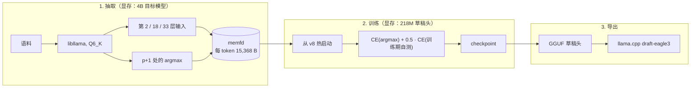

# spark-eagle3-forge

[English](README.md) | **简体中文**

为 Spark-X2.6-4B 重新训练 EAGLE-3 草稿头，让推测解码在中文环境可以起到正面效果。公开的草稿头（`VitreousCut/Spark-X2.6-4B-EAGLE3`，下称 v8）在作者自己的评测上能到 p0 0.46–0.92（同域散文与原始文字提示；同样内容换成模型自己的 chat 模板后只有 0.325），但在中文任务上只有 0.01–0.33，其中一些低于 0.12 的盈亏平衡点——到了那里，推测解码反而拖慢推理。本项目监督微调后，8 个真实中文提示的离屏平均草稿接受率从 **0.148 升到 0.316**；其中 5 个提示在同一台机器上走 llama.cpp 实测为 **0.148 → 0.348**，解码加速 **1.19 倍**。

## 结果

离屏回放（`eval_p0.py`，greedy，每个提示生成 256 token），以及同一个头在 llama.cpp 里的实测（`--spec-type draft-eagle3 --spec-draft-n-max 1`，greedy，128 token，5 个提示）：

| 工作负载 | v8 | 重训后 | Δ |
|---|---:|---:|---:|
| 对话 + 思考 | 0.2461 | **0.3281** | +0.08 |
| 对话，不思考 | 0.0441 | **0.2353** | +0.19 |
| 散文 + 思考 | 0.0469 | **0.3086** | +0.26 |
| 散文，不思考 | 0.0000 | **0.2024** | +0.20 |
| 代码 | 0.1992 | **0.2070** | +0.01 |
| 改写 / 抄写 | 0.1562 | **0.2031** | +0.05 |
| **8 个真实中文提示** | **0.1480** | **0.3159** | **+0.17** |
| 同样 5 个提示，走 llama.cpp | 0.1481 | **0.3480** | +0.20 |

p0 是「第一个草稿 token 被目标模型接受」的比例，与机器无关。验证前向实测有 +12% 的固定开销，因此加速比 $= (1+p_0)/1.12$：盈亏平衡在 p0 ≈ 0.12，0.348 就是 1.20 倍。同一批提示从 12.6 ms/token 降到 10.6 ms/token。

## 为什么 v8 在中文上效果不乐观

草稿头只输出 32,000 个 logit，通过 `d2t` 散射回目标模型 131,072 的词表，集合之外的 token 全被置为 −∞。所以

$$p_0 \le \text{覆盖率} = \Pr[\text{目标模型的 argmax} \in \text{草稿词表}]$$

v8 的 32K 词表是某一个英文/代码语料的切片。在录下来的中文工作负载上，它只覆盖 **1.1% 的 CJK token** 和 **49.9% 的 ASCII token**，综合上限 0.245。用中文指令数据、中文散文和代码重新挑选同样的 32,000 个槽位，覆盖率升到 **0.939**，而词表本身 84.8% 是 CJK。只有 `lm_head` 需要重学（32,000 行中 4,243 行不变），其余全部从 v8 热启动。

## 项目特点

### 使用量化后的权重训练草稿头
特征直接从 **llama.cpp 真正运行的量化 Q6_K GGUF** 里提取，而不是 F32 的 HF 检查点。训练和部署看到的是同一份权重，不用再下载 8.2 GB 的 bf16 HF 权重，也不需要把融合过的 `attn_qkv` 拆回三块。代价是特征带有 bf16 舍入，所以评测端必须用同样的方式舍入。

### 特征存入内存，不写入硬盘
每个 token 一条记录（3 × 2560 个 bf16 隐状态 + 下一个 token + 目标模型的 argmax，共 15,368 字节），由 C++ shim 直接写进 `os.memfd_create` 的映射：不写 NVMe、不占用 tmpfs 配额、不需要 root。训练用跨步的 numpy 视图从这块映射里随机取窗口，数据不会经过 Python 对象往返。

### 硬件要求低
**12 GiB** 级别的显卡就够，因为抽取和训练轮流占用 GPU。4B 目标模型要 ~6 GiB 显存，训练态的草稿头（fp32 参数、梯度、两个 AdamW 动量）要 ~4 GiB，两者不可能同时常驻。所以驱动按「段」工作——抽一段、把目标模型请下卡、训练这一段、存 checkpoint、重复——并在目标模型占用显卡期间，把草稿头和优化器状态搬到 CPU。

### 内存占用由「训练阶段」决定，与语料大小无关
一段是 8–15 GiB 的特征（50 万–100 万 token）。完整的 2200 万 token 规模需要 338 GB 记录，这正是流程必须分段、而不是开一块大缓冲的原因，也是每段结束都要先存 checkpoint 再进下一段的原因。

### 训练目标为模型自己的 argmax
运行时的草稿永远取 argmax，所以对着目标模型的概率分布做交叉熵等于教它一件它从不做的事。第二项损失把草稿**自己**挑出的 token 当作下一个输入喂回去再算一次交叉熵，那正是草稿被接受时面临的情形。

## 工作流程



## 快速开始

`datasets/`、`checkpoints/`、`logs/` 都在 `.gitignore` 里，全新 clone 需要先生成：语料（`scripts/fetch_corpora.sh`）、草稿词表（`scripts/build_vocab.py`）、热启动 checkpoint（`scripts/init_head.py`）与提示文件（`scripts/make_prompts.py`），命令见 [`AGENTS.md`](AGENTS.md) §6。Python 用仓库根目录的 `.venv`（指向你自己的 torch 环境）。

```bash
export LLAMACPP_ROOT=…      # 带 layer-input 补丁的 llama.cpp（见 docs/facts.md §2.4）
export MODELS_DIR=…         # 存 <target>.gguf 与公开的 v8 头

cmake -S csrc -B csrc/build -G Ninja -DLLAMACPP_ROOT="$LLAMACPP_ROOT" && cmake --build csrc/build

# 抽取 → 训练 → checkpoint：8 段、每段 100 万 token、共 8000 步
.venv/bin/python -m spark_eagle3.train --model "$MODELS_DIR/<target>.gguf" \
    --d2t datasets/vocab/d2t_v1_32k.i32 --init checkpoints/head_init.pt \
    --out checkpoints/s2a --steps 8000 --segments 8 --tokens-per-segment 1000000

# 任意 checkpoint 的离屏 p0
.venv/bin/python -m spark_eagle3.eval_p0 --model "$MODELS_DIR/<target>.gguf" \
    --head checkpoints/s2a.pt --dtype bfloat16 --n-gen 256 \
    --prompt-file datasets/prompts/rendered/chat_think.txt --out logs/p0.json

# 草稿头 → GGUF
.venv/bin/python -m spark_eagle3.export_gguf --ckpt checkpoints/s2a.pt \
    --out "$MODELS_DIR/spark-eagle3-s2a.gguf" --tokenizer-from "$MODELS_DIR/spark-eagle3-v8.gguf"
```

带着草稿头启动服务：

```bash
llama-server -m "$MODELS_DIR/<target>.gguf" -md "$MODELS_DIR/spark-eagle3-s2a.gguf" \
    --spec-type draft-eagle3 --spec-draft-n-max 1 \
    -c 131072 -ctk f16 -ctv f16 -ngl 99 --parallel 1 -fa on
```

## 目录结构

| 路径 | 内容 |
|---|---|
| `csrc/` | 包在 libllama 外面的 C++ shim：特征抽取、分词器、argmax（对外是纯 C ABI） |
| `spark_eagle3/` | `extract.py`、`train.py`、`eval_p0.py`、`export_gguf.py`、`model.py`、memfd 存储 |
| `scripts/` | 语料下载、词表构建与打分、热启动、提示渲染、线上 p0 |
| `docs/` | [`facts.md`](docs/facts.md)（模型几何、成本模型、词表天花板）、[`notes.md`](docs/notes.md)（协议、实测、失败尝试） |
| `AGENTS.md` | 目的、硬约束、设计、已验证命令、门槛、坑（给编码代理看） |

## 目前已知的问题

- **两个偏英文的语体略有退步**（「对话 + 思考」和 `zh_tech`，线上都 −0.03）。它们恰好是 v8 词表本来就覆盖得好的两个提示，而重建的 32K 里有 27,757 行是 v8 没有的（绝大多数为 CJK；词表中含 CJK 的 id 是 27,134）。因此不建议将这个头用在纯英文工作负载上。
- **收益在第 500 步就基本到顶。** 绝大部分提升来自第一段，之后只有最纯粹的中文语体继续变好。下一步的边际收益在**更多唯一数据**（扩到 2200 万 token）或中文思考语料，而不是更多步数。
- **只针对单序列解码。** 这里的推测解码都在 `--parallel 1` 下测量，本仓库没有为批量服务调过参。

## 许可证

**代码**：BSD 3-Clause，见 [`LICENSE`](LICENSE) —— Copyright (c) 2026, 條風。

**训练所得的草稿头**：Apache-2.0。
> 其为 VitreousCut/Spark-X2.6-4B-EAGLE3（Apache-2.0）的衍生物，故发布权重时一并附上授权全文、保留版权声明并注明修改内容。详见 [`THIRD-PARTY-NOTICES.md`](THIRD-PARTY-NOTICES.md)。

## 声明

- 基础模型为 [SC117/Spark-X2.6-4B-abliterated-FIT-GGUF](https://huggingface.co/SC117/Spark-X2.6-4B-abliterated-FIT-GGUF) 的 Q6_K 量化版本，基于 [XHToken/Spark-X2.6-4B-Base](https://huggingface.co/XHToken/Spark-X2.6-4B-Base)。
- 草稿头基于 [VitreousCut/Spark-X2.6-4B-EAGLE3](https://huggingface.co/VitreousCut/Spark-X2.6-4B-EAGLE3) v8 检查点微调衍生。
- 训练语料：
  - [m-a-p/COIG-CQIA](https://huggingface.co/datasets/m-a-p/COIG-CQIA)；
  - [YeungNLP/firefly-train-1.1M](https://huggingface.co/datasets/YeungNLP/firefly-train-1.1M)；
  - [wikimedia/wikipedia](https://huggingface.co/datasets/wikimedia/wikipedia)。

  COIG-CQIA 与 firefly 的卡片没有声明授权，商用再分发衍生权重前请自行评估（详见 [`THIRD-PARTY-NOTICES.md`](THIRD-PARTY-NOTICES.md)）。
- 推理框架 [ggml-org/llama.cpp](https://github.com/ggml-org/llama.cpp)。
- 训练框架 [pytorch/pytorch](https://github.com/pytorch/pytorch) 等。

* 完整的第三方协议和版权声明请参阅 [THIRD-PARTY-NOTICES.md](THIRD-PARTY-NOTICES.md)。

> DeepSeek V4.1 Flash 参与构建。
