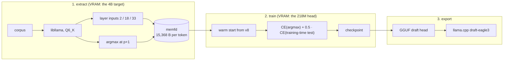

# spark-eagle3-forge

**English** | [简体中文](README.cn.md)

Retraining the EAGLE-3 draft head for Spark-X2.6-4B so that speculative decoding has a positive effect in Chinese. The published head (`VitreousCut/Spark-X2.6-4B-EAGLE3`, "v8" below) reaches p0 0.46–0.92 on its author's in-domain prose and raw-text evals — 0.325 once the same prompts go through the model's own chat template — but only 0.01–0.33 across Chinese tasks, some of them below the 0.12 break-even point, where speculative decoding makes inference slower instead. After the supervised fine-tuning in this project, the offline mean draft acceptance over eight realistic Chinese prompts rises from **0.148 to 0.316**; five of those prompts, measured through llama.cpp on the same machine, go **0.148 → 0.348**, a **1.19x** decode speed-up.

## Results

Offline replay (`eval_p0.py`, greedy, 256 generated tokens per prompt), and the same head through llama.cpp (`--spec-type draft-eagle3 --spec-draft-n-max 1`, greedy, 128 tokens, 5 prompts):

| Workload | v8 | retrained | Δ |
|---|---:|---:|---:|
| chat + thinking | 0.2461 | **0.3281** | +0.08 |
| chat, no thinking | 0.0441 | **0.2353** | +0.19 |
| prose + thinking | 0.0469 | **0.3086** | +0.26 |
| prose, no thinking | 0.0000 | **0.2024** | +0.20 |
| code | 0.1992 | **0.2070** | +0.01 |
| copy / rewrite | 0.1562 | **0.2031** | +0.05 |
| **8 realistic Chinese prompts** | **0.1480** | **0.3159** | **+0.17** |
| same 5 prompts, through llama.cpp | 0.1481 | **0.3480** | +0.20 |

p0 is the share of first drafted tokens the target accepts, so it is hardware independent. The verification forward pass costs a measured +12% fixed overhead, so speed-up $= (1+p_0)/1.12$: break-even is p0 ≈ 0.12, and 0.348 is 1.20x. The same prompts went from 12.6 ms/token to 10.6 ms/token.

## Why v8 does not do well in Chinese

The head emits only 32,000 logits and scatters them back into the target's 131,072-token vocabulary through `d2t`; every token outside that set is set to −∞. Therefore

$$p_0 \le \text{coverage} = \Pr[\text{target argmax} \in \text{draft vocabulary}]$$

v8's 32K vocabulary is a slice of one English/code corpus. On the recorded Chinese workloads it covers only **1.1% of CJK tokens** and **49.9% of ASCII tokens**, an aggregate ceiling of 0.245. Re-picking the same 32,000 slots from Chinese instruction data, Chinese prose and code lifts coverage to **0.939**, with 84.8% of the vocabulary itself being CJK. Only `lm_head` has to be re-learned (4,243 of its 32,000 rows stay unchanged); everything else warm-starts from v8.

## Project highlights

### Trained on the quantised weights
Features are extracted directly from the **quantised Q6_K GGUF that llama.cpp actually runs**, not from an F32 HF checkpoint. Training and deployment see the same weights, there is no 8.2 GB bf16 HF download, and the fused `attn_qkv` never has to be split back into three. The cost is that features carry bf16 rounding, so the evaluator has to round the same way.

### Features are stored in memory, never written to disk
Each token is one record (3 × 2560 bf16 hidden states + the next token + the target's argmax, 15,368 bytes) written by the C++ shim straight into an `os.memfd_create` mapping: no NVMe writes, no tmpfs quota, no root. Training samples random windows out of that mapping through a strided numpy view, so the data never round-trips through Python objects.

### Modest hardware requirements
A **12 GiB**-class GPU is enough, because extraction and training take turns. The 4B target needs ~6 GiB of VRAM and the head in training state (fp32 parameters, gradients, two AdamW moments) needs ~4 GiB, so they cannot be resident together. The driver therefore works in segments — extract one segment, take the target off the card, train on that segment, checkpoint, repeat — and moves the head and its optimiser state to the CPU while the target model owns the GPU.

### Memory use is set by one training segment, not by corpus size
A segment is 8–15 GiB of features (0.5–1M tokens). The full 22M-token scale would need 338 GB of records, which is exactly why the pipeline has to be segmented instead of using one large buffer, and why every segment checkpoints before the next one starts.

### The training target is the model's own argmax
The runtime draft always takes an argmax, so a cross-entropy against the target's probability distribution would teach it something it never does. A second loss term feeds the token the draft **itself** picked back in as the next input and computes a second cross-entropy — exactly the situation it faces whenever a draft is accepted.

## Pipeline



## Quick start

`datasets/`, `checkpoints/` and `logs/` are gitignored, so a fresh clone has to generate them first: corpora (`scripts/fetch_corpora.sh`), the draft vocabulary (`scripts/build_vocab.py`), the warm-start checkpoint (`scripts/init_head.py`) and the rendered prompts (`scripts/make_prompts.py`) — all commands are in [`AGENTS.md`](AGENTS.md) §6. Python is the repo-root `.venv`, pointing at your own torch environment.

```bash
export LLAMACPP_ROOT=…      # llama.cpp checkout with the layer-input patch (docs/facts.md §2.4)
export MODELS_DIR=…         # holds <target>.gguf and the published v8 head

cmake -S csrc -B csrc/build -G Ninja -DLLAMACPP_ROOT="$LLAMACPP_ROOT" && cmake --build csrc/build

# extract → train → checkpoint: eight segments of one million tokens, 8000 steps
.venv/bin/python -m spark_eagle3.train --model "$MODELS_DIR/<target>.gguf" \
    --d2t datasets/vocab/d2t_v1_32k.i32 --init checkpoints/head_init.pt \
    --out checkpoints/s2a --steps 8000 --segments 8 --tokens-per-segment 1000000

# offline p0 of any checkpoint
.venv/bin/python -m spark_eagle3.eval_p0 --model "$MODELS_DIR/<target>.gguf" \
    --head checkpoints/s2a.pt --dtype bfloat16 --n-gen 256 \
    --prompt-file datasets/prompts/rendered/chat_think.txt --out logs/p0.json

# draft head → GGUF
.venv/bin/python -m spark_eagle3.export_gguf --ckpt checkpoints/s2a.pt \
    --out "$MODELS_DIR/spark-eagle3-s2a.gguf" --tokenizer-from "$MODELS_DIR/spark-eagle3-v8.gguf"
```

Serve it with the head attached:

```bash
llama-server -m "$MODELS_DIR/<target>.gguf" -md "$MODELS_DIR/spark-eagle3-s2a.gguf" \
    --spec-type draft-eagle3 --spec-draft-n-max 1 \
    -c 131072 -ctk f16 -ctv f16 -ngl 99 --parallel 1 -fa on
```

## Layout

| Path | What |
|---|---|
| `csrc/` | C++ shim over libllama: feature extraction, tokenizer, argmax (plain C ABI) |
| `spark_eagle3/` | `extract.py`, `train.py`, `eval_p0.py`, `export_gguf.py`, `model.py`, memfd store |
| `scripts/` | corpus download, vocabulary build/score, warm start, prompt rendering, online p0 |
| `docs/` | [`facts.md`](docs/facts.md) (model geometry, cost model, vocabulary ceiling), [`notes.md`](docs/notes.md) (protocol, measurements, failed attempts) |
| `AGENTS.md` | purpose, constraints, design, verified commands, gates, pitfalls (for coding agents) |

## Known issues

- **Two English-heavy registers got slightly worse** (`chat + thinking` and `zh_tech`, both −0.03 online). They are the two prompts whose vocabulary v8 already covered well, while 27,757 rows of the rebuilt 32K did not exist in v8 at all (almost all of them CJK; the vocabulary has 27,134 CJK ids). So this head is not recommended for a purely English workload.
- **Gains saturate by the 500th step.** Almost all of the improvement arrives in the first segment; further steps only keep helping the most purely Chinese register. The next marginal token is more **unique** data (scaling to 22M tokens) or Chinese thinking traces, not more steps.
- **Single-sequence decode only.** Speculative decoding here is measured at `--parallel 1`; nothing in this repo was tuned for batched serving.

## License

**Code**: BSD 3-Clause — see [`LICENSE`](LICENSE), Copyright (c) 2026, 條風.

**Trained head**: Apache-2.0. 
> As this is a derivative of VitreousCut/Spark-X2.6-4B-EAGLE3 (Apache-2.0), the full license text, copyright notice, and details of the modifications are included when the weights are released. For more information, see [`THIRD-PARTY-NOTICES.md`](THIRD-PARTY-NOTICES.md).

## Attribution

- Base model: the Q6_K quantisation [SC117/Spark-X2.6-4B-abliterated-FIT-GGUF](https://huggingface.co/SC117/Spark-X2.6-4B-abliterated-FIT-GGUF), built on [XHToken/Spark-X2.6-4B-Base](https://huggingface.co/XHToken/Spark-X2.6-4B-Base).
- Draft head: fine-tuned from the [VitreousCut/Spark-X2.6-4B-EAGLE3](https://huggingface.co/VitreousCut/Spark-X2.6-4B-EAGLE3) v8 checkpoint.
- Training corpora:
  - [m-a-p/COIG-CQIA](https://huggingface.co/datasets/m-a-p/COIG-CQIA);
  - [YeungNLP/firefly-train-1.1M](https://huggingface.co/datasets/YeungNLP/firefly-train-1.1M);
  - [wikimedia/wikipedia](https://huggingface.co/datasets/wikimedia/wikipedia).

  The COIG-CQIA and firefly cards state no licence, so assess the terms yourself before redistributing derived weights commercially — see [`THIRD-PARTY-NOTICES.md`](THIRD-PARTY-NOTICES.md).
- Inference framework: [ggml-org/llama.cpp](https://github.com/ggml-org/llama.cpp).
- Training framework: [pytorch/pytorch](https://github.com/pytorch/pytorch) and others.

* Full third-party licences and copyright notices are in [THIRD-PARTY-NOTICES.md](THIRD-PARTY-NOTICES.md).

> Built with assistance from DeepSeek V4.1 Flash.
