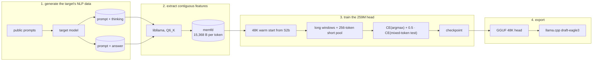

# spark-eagle3-forge

**English** | [简体中文](README.cn.md)

Retraining the EAGLE-3 draft head for Spark-X2.6-4B so speculative decoding pays off on the real workload: Chinese↔English translation, summarisation, document organisation and chat. The published v8 head was trained on English and code text, and its 32K draft vocabulary covers only about half of ASCII and 1.1% of CJK; the S2a → S2b → S3 stages lift the same-matrix mean from **0.344 to 0.495**, with 48K bilingual vocabulary coverage of **0.979–0.995** and measured decode speed-ups of **1.15–1.35x**. (v8's 0.148 is a different prompt set — see the legacy card.)

| | |
|---|---|
| Released head | [`TiaoFeng/Spark-X2.6-4B-EAGLE3-Chinese-retrain`](https://huggingface.co/TiaoFeng/Spark-X2.6-4B-EAGLE3-Chinese-retrain) — `spark-eagle3-s3-48k-q8.gguf` (268 MiB) |
| Weight parents | S2b and S2a heads in that repo's `legacy/`; S2a is itself a retrain warm-started from `VitreousCut/Spark-X2.6-4B-EAGLE3` |
| Target | Spark-X2.6-4B, Q6_K |

## Results

NLP matrix: 48 prompts across seven workloads, target at `temperature = 1.0` with a greedy draft, through `llama-server` with `--spec-draft-n-max 1`. `p0` is the first-draft acceptance.

| Workload | S2a (32K) | S2b (48K) | S3 (48K) |
|---|---:|---:|---:|
| chat | 0.276 | 0.304 | **0.380** |
| translate Chinese → English | 0.449 | 0.601 | **0.638** |
| translate English → Chinese | 0.325 | 0.480 | **0.530** |
| summarise Chinese (zh → zh) | 0.333 | 0.469 | **0.479** |
| summarise English (en → zh) | 0.277 | 0.424 | **0.453** |
| organise documents | 0.421 | 0.516 | **0.532** |
| long context | 0.298 | 0.395 | **0.419** |
| **all** | **0.344** | **0.460** | **0.495** |

Three probes the matrix does not cover. The first two replay the same 48 prompts offline through the head in PyTorch (greedy, 128 tokens); the third repeats one document to each length and scores 64 tokens:

| probe | S2b | S3 |
|---|---:|---:|
| p0, 48-prompt matrix, offline replay | 0.457 | **0.502** |
| answer channel — the same prompts rendered without thinking | 0.385 | **0.462** |
| p0 at 2k / 8k / 16k / 32k session context | 0.484 / 0.406 / 0.281 / 0.219 | **0.594 / 0.422 / 0.375 / 0.250** |

- vocabulary coverage of the target's top-1: **0.979–0.995** (48K), against 0.81–0.98 (32K).
- the head converts **0.570** of the target's top-1 probability (S2b: 0.529).
- the replay scores every generated position against the target's argmax, while llama.cpp counts accepted drafts per verification step; on the same 48 prompts with a greedy target (temperature 0) the two read **0.502 and 0.549** (both step-weighted), so the replay is 0.047 low there. The deployment matrix is a different protocol (temperature 1.0) and reads 0.495.
- decode is **1.15–1.35x** faster at every length measured, including 13–14k context. The head's only cost is prefill: with `-md` the draft also processes the prompt, which makes prompt processing about 28% slower at 14k and a few percent slower at short context. That is a fixed per-request cost, so it amortises over the reply (13–14k: 0.92x at 128-token replies, 1.06x at 512).

The earlier v8 → S2a comparison (eight Chinese prompts: 0.148 → 0.316 offline; a five-prompt online A/B: 0.148 → 0.348, 1.19x) is preserved in the legacy card (`legacy/README.md`). It uses a different prompt set and is not directly comparable with the table above.

## The vocabulary ceiling

The draft emits only its draft vocabulary and scatters it into the target's 131,072-token vocabulary through `d2t`; every token outside the set is −∞, so

$$p_0 \le \text{coverage} = \Pr[\text{target argmax} \in \text{draft vocabulary}].$$

v8's 32K vocabulary appears to be a slice of one English/code corpus: on the recorded workload it covers 1.1% of CJK tokens and 49.9% of ASCII tokens, a ceiling of 0.245. The first stage (S2a) re-picked the 32K slots from Chinese data and reached 0.939 coverage; its D1 mean is 0.344. The second stage (S2b) keeps those 32K ids and appends 16K English/ASCII ids, ranked from an English Wikipedia shard and the recorded NLP steps: coverage 0.979–0.995, D1 mean 0.460. S3 keeps that vocabulary unchanged, so the remaining gap is head quality, not coverage.

## What S3 changes

- **Answer channel.** S2b's response text is only 0.46% answer — 128 of 3,520 responses close thinking inside the budget and carry a short answer — so the phase was effectively untrained: 0.385 at 128 tokens against 0.493 for thinking at 900. S3 generates the same tasks with thinking disabled (4.03M tokens) and trains on them; every workload improves, organisation by +0.106 on that probe.
- **Short documents.** The window sampler used to drop any document shorter than `seq_len + 1` rows — exactly the shape of a short answer. A second, disjoint 256-token window pool now trains them; chat gains +0.076 on the matrix (+0.086 on the offline probe), the largest of any workload.
- **Long context.** Consecutive long-task records are joined into documents of about 29k tokens, so the head sees contexts past the 16k extraction window: 16k p0 rises 0.281 → 0.375.
- **Data**: 7.77M training rows sampled from 8.89M tokens the target generated itself (4.86M thinking + 4.03M answer). Public text appears only inside prompts; the training target is always the model's own output.
- **Run**: 4 segments of ~1.94M rows, 4,000 steps of 2,048 tokens; final training CE 1.94 / top-1 0.673.

S2b's contribution is unchanged and still the base: 3.46M rows of the thinking channel, contiguous 2k-sub-batch extraction, and the CE(argmax) + 0.5 × mixed-token training-time test loss.

## Pipeline



Features come from the **quantised Q6_K GGUF that llama.cpp serves**, are written by the C++ shim straight into an `os.memfd_create` mapping (no NVMe, no tmpfs quota, no root), and extraction and training take turns on a single consumer GPU. The full design is in `AGENTS.md` and `docs/facts.md`.

## Quick start

The released head is `spark-eagle3-s3-48k-q8.gguf`; its 48K `d2t` is embedded in the GGUF. `datasets/`, `checkpoints/` and `logs/` are gitignored, so a fresh clone has to generate them first. The regular cycle is in [`AGENTS.md`](AGENTS.md) §6; the short version:

```bash
export LLAMACPP_ROOT=…   # llama.cpp with the spark2_5 layer-input patch
export MODELS_DIR=…      # the target Q6_K GGUF and the released head

cmake -S csrc -B csrc/build -G Ninja -DLLAMACPP_ROOT="$LLAMACPP_ROOT" && cmake --build csrc/build

# 48K vocabulary + warm start from the S2a checkpoint (history: S2a -> S2b)
.venv/bin/python scripts/record_steps.py --model "$MODELS_DIR/<target>.gguf" \
    --prompt-dir datasets/prompts/nlp --out logs/nlp/steps.i32
.venv/bin/python scripts/build_union_vocab.py --model "$MODELS_DIR/<target>.gguf" \
    --base datasets/vocab/d2t_v1_32k.i32 --out datasets/vocab/d2t_v2_48k
.venv/bin/python scripts/init_head.py --from-checkpoint checkpoints/s2a.pt \
    --d2t datasets/vocab/d2t_v2_48k.i32 --out checkpoints/head_init_48k.pt

# generate both channels, then train S3 from the S2b head
.venv/bin/python scripts/gen_nlp_data.py --server "$LLAMACPP_ROOT/build/bin/llama-server" \
    --model "$MODELS_DIR/<target>.gguf" --out-dir datasets/nlp
.venv/bin/python scripts/gen_nlp_data.py --server "$LLAMACPP_ROOT/build/bin/llama-server" \
    --model "$MODELS_DIR/<target>.gguf" --out-dir datasets/nlp_answer \
    --think-off --n-predict 512 --long-n-predict 640
.venv/bin/python scripts/train_s2b.py --model "$MODELS_DIR/<target>.gguf" \
    --d2t datasets/vocab/d2t_v2_48k.i32 --init checkpoints/s2b.pt \
    --out checkpoints/s3 --steps 4000 --segments 4 --tokens-per-segment 2300000 \
    --weights sum=0.09,trans=0.17,org=0.06,chat=0.09,long=0.09 \
    --answer-dir datasets/nlp_answer \
    --answer-weights sum=0.06,trans=0.15,org=0.05,chat=0.06,long=0.09 \
    --short-seq-len 256 --short-mix 0.25 --chars-per-token 2.2 \
    --long-concat-chars 64000 --n-ctx 32768

# export, quantise, serve
.venv/bin/python -m spark_eagle3.export_gguf --ckpt checkpoints/s3.pt \
    --out "$MODELS_DIR/spark-eagle3-s3-48k.gguf" --name spark-eagle3-s3-48k \
    --tokenizer-from "$MODELS_DIR/spark-eagle3-v8.gguf"
scripts/quantize_head.sh checkpoints/s3.pt "$MODELS_DIR/spark-eagle3-s3-48k-q8.gguf"
llama-server -m "$MODELS_DIR/<target>.gguf" -md "$MODELS_DIR/spark-eagle3-s3-48k-q8.gguf" \
    --spec-type draft-eagle3 --spec-draft-n-max 1 \
    -c 131072 -ctk f16 -ctv f16 -ngl 99 --parallel 1 -fa on
```

## Known issues

- **32k context is still weak** (0.250, against 0.219 for S2b). Decoding is faster at 13–14k, the length the A/B measured; 32k itself was not A/B'd, and the gain shrinks as the context grows.
- **The long-context prompts overlap the training text.** The matrix's long-context prompts use this project's `docs/notes.md` as context, and the English half of the `long` task is built from the same file, so that row's +0.024 is optimistic. The independent evidence is the context probe (+0.094 at 16k), whose text is not part of any generated training document; its continuation is synthetic, so only the direction is usable.
- **The offline probes are not the runtime.** They replay only the generated rows, while llama.cpp's draft decoder processes every verified token, prompt included; the omission grows with prompt length. Compare S2b with S3 on those probes (both omit it), and use the online matrix for runtime numbers.
- **One training seed.** The aggregate gains are far larger than the ±0.03 per-prompt noise, but no second seed was run.
- **1.30x is not met on 128-token replies** (1.19x short-context mean, 1.11x over all 48). That is a reply-length artefact as much as a head result: decode is 1.15–1.35x, and prefill is a fixed per-request cost.
- **Vocabulary partly in-sample**: the 16K English ids were ranked partly from the recorded steps of the same 48 evaluation prompts (weight 50), alongside an English Wikipedia shard. The head was not trained on those instructions; the long-context contexts overlap, see the previous bullet.
- **Single sequence only**: measured at `--parallel 1`; batched serving was not tuned.
- **Spark only**: EAGLE-3 head for the `spark2_5` architecture, layers 2/18/33.

## Licence

**Code**: BSD 3-Clause — see [`LICENSE`](LICENSE), Copyright (c) 2026, 條風.

**Head**: Apache-2.0, a derivative of `VitreousCut/Spark-X2.6-4B-EAGLE3` via this repo's S2a and S2b heads; the released NOTICE lists the changes. Training corpora: COIG-CQIA, firefly-train-1.1M, wikipedia (Chinese and English; the English shard also feeds vocabulary selection and the generation prompts) and target-generated text. See [`THIRD-PARTY-NOTICES.md`](THIRD-PARTY-NOTICES.md).

## Attribution

- Target: [SC117/Spark-X2.6-4B-abliterated-FIT-GGUF](https://huggingface.co/SC117/Spark-X2.6-4B-abliterated-FIT-GGUF) (Q6_K), built on [XHToken/Spark-X2.6-4B-Base](https://huggingface.co/XHToken/Spark-X2.6-4B-Base).
- Draft head: [VitreousCut/Spark-X2.6-4B-EAGLE3](https://huggingface.co/VitreousCut/Spark-X2.6-4B-EAGLE3) v8, then this repo's 32K S2a head, then S2b, then S3.
- Training corpora: [m-a-p/COIG-CQIA](https://huggingface.co/datasets/m-a-p/COIG-CQIA), [YeungNLP/firefly-train-1.1M](https://huggingface.co/datasets/YeungNLP/firefly-train-1.1M), [wikimedia/wikipedia](https://huggingface.co/datasets/wikimedia/wikipedia).
- Inference: [ggml-org/llama.cpp](https://github.com/ggml-org/llama.cpp); training: [pytorch/pytorch](https://github.com/pytorch/pytorch) and others.

* Full third-party licences and copyright notices are in [THIRD-PARTY-NOTICES.md](THIRD-PARTY-NOTICES.md).
