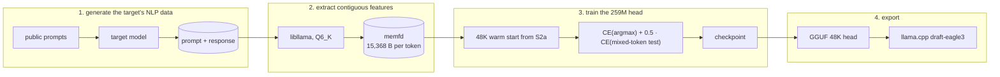

# spark-eagle3-forge

**English** | [简体中文](README.cn.md)

Retraining the EAGLE-3 draft head for Spark-X2.6-4B so speculative decoding pays off on the real workload: Chinese↔English translation, summarisation, document organisation and chat. The published v8 head is tuned for English and code text; after two retraining stages, the S2a → S2b mean acceptance on a 48-prompt NLP matrix rises from **0.344 to 0.460**, with 48K bilingual vocabulary coverage of **0.979–0.995** and an estimated **1.30x** decode speed-up.

| | |
|---|---|
| Released head | [`TiaoFeng/Spark-X2.6-4B-EAGLE3-Chinese-retrain`](https://huggingface.co/TiaoFeng/Spark-X2.6-4B-EAGLE3-Chinese-retrain) — `spark-eagle3-s2b-48k.gguf` |
| Weight parent | the 32K S2a head in that repo's `legacy/`, itself a retrain warm-started from `VitreousCut/Spark-X2.6-4B-EAGLE3` |
| Target | Spark-X2.6-4B, Q6_K |

## Results

NLP matrix: 48 prompts across seven workloads, `temperature = 1.0`, greedy, through `llama-server` with `--spec-draft-n-max 1`. `p0` is the first-draft acceptance; the verification pass costs about 12%, so speed-up ≈ `(1 + p0) / 1.12`.

| Workload | S2a (32K) | S2b (48K) | Δ |
|---|---:|---:|---:|
| chat | 0.276 | 0.304 | +0.028 |
| translate Chinese → English | 0.449 | **0.601** | +0.152 |
| translate English → Chinese | 0.325 | **0.480** | +0.155 |
| summarise Chinese (zh → zh) | 0.333 | 0.469 | +0.136 |
| summarise English (en → zh) | 0.277 | 0.424 | +0.147 |
| organise documents | 0.421 | 0.516 | +0.095 |
| long context | 0.298 | 0.395 | +0.097 |
| **all** | **0.344** | **0.460** | **+0.116** |

- vocabulary coverage of the target's top-1: **0.979–0.995** (48K), against 0.81–0.98 (32K).
- the head converts **0.529** of the target's top-1 probability (S2a: 0.396).
- estimated speed-up: **1.30x** (S2a: 1.20x); the controlled wall-clock A/B for this head is still pending.

The earlier v8 → S2a comparison (eight Chinese prompts: 0.148 → 0.316 offline; a five-prompt online A/B: 0.148 → 0.348, 1.19x) is preserved in the 32K legacy card (`legacy/README.md`). It uses a different prompt set and is not directly comparable with the table above.

## The vocabulary ceiling

The draft emits only its draft vocabulary and scatters it into the target's 131,072-token vocabulary through `d2t`; every token outside the set is −∞, so

$$p_0 \le \text{coverage} = \Pr[\text{target argmax} \in \text{draft vocabulary}].$$

v8's 32K vocabulary appears to be a slice of one English/code corpus: on the recorded workload it covers 1.1% of CJK tokens and 49.9% of ASCII tokens, a ceiling of 0.245. The first stage (S2a) re-picked the 32K slots from Chinese data and reached 0.939 coverage; its D1 mean is 0.344. The second stage (S2b) keeps those 32K ids and appends 16K English/ASCII ids, ranked from an English Wikipedia shard and the recorded NLP steps: coverage 0.979–0.995, D1 mean 0.460.

## What S2b changes

- **Data**: 3.46M training tokens, drawn from ~4.78M tokens generated by the target itself — summaries, translations, document organisations and chat, with long-context documents. The target's own output is the training distribution; public text is only used as prompts, never as the training target.
- **Features**: contiguous extraction, 2,048-token sub-batches without a KV reset, up to 16k context, so a response position sees the whole document prefix.
- **Loss**: CE against the target's argmax plus 0.5 × a mixed-token training-time test; each position feeds the draft's own argmax with probability 0.5 and the target token otherwise.
- **Vocabulary**: a 48K union, warm-started from the S2a head; 32,000 rows are kept and 16,000 English/ASCII rows are new.
- **Run**: 4 segments, 2,000 steps of 2 × 1,024 tokens; final training CE 2.015 / top-1 0.657.

## Pipeline



Features come from the **quantised Q6_K GGUF that llama.cpp serves**, are written by the C++ shim straight into an `os.memfd_create` mapping (no NVMe, no tmpfs quota, no root), and extraction and training take turns on a single consumer GPU. The full design is in `AGENTS.md` and `docs/facts.md`.

## Quick start

The released head is `spark-eagle3-s2b-48k.gguf`; its 48K `d2t` is embedded in the GGUF. `datasets/`, `checkpoints/` and `logs/` are gitignored, so a fresh clone has to generate them first. All commands are in [`AGENTS.md`](AGENTS.md) §6; the short version:

```bash
export LLAMACPP_ROOT=…   # llama.cpp with the spark2_5 layer-input patch
export MODELS_DIR=…      # the target Q6_K GGUF and the v8 head

cmake -S csrc -B csrc/build -G Ninja -DLLAMACPP_ROOT="$LLAMACPP_ROOT" && cmake --build csrc/build

# 48K vocabulary + warm start from the S2a checkpoint
.venv/bin/python scripts/record_steps.py --model "$MODELS_DIR/<target>.gguf" \
    --prompt-dir datasets/prompts/nlp --out logs/nlp/steps.i32
.venv/bin/python scripts/build_union_vocab.py --model "$MODELS_DIR/<target>.gguf" \
    --base datasets/vocab/d2t_v1_32k.i32 --out datasets/vocab/d2t_v2_48k
.venv/bin/python scripts/init_head.py --from-checkpoint checkpoints/s2a.pt \
    --d2t datasets/vocab/d2t_v2_48k.i32 --out checkpoints/head_init_48k.pt

# generate the NLP corpus and train
.venv/bin/python scripts/gen_nlp_data.py --server "$LLAMACPP_ROOT/build/bin/llama-server" \
    --model "$MODELS_DIR/<target>.gguf" --out-dir datasets/nlp
.venv/bin/python scripts/train_s2b.py --model "$MODELS_DIR/<target>.gguf" \
    --d2t datasets/vocab/d2t_v2_48k.i32 --init checkpoints/head_init_48k.pt \
    --out checkpoints/s2b --steps 2000 --segments 4

# export and serve
.venv/bin/python -m spark_eagle3.export_gguf --ckpt checkpoints/s2b.pt \
    --out "$MODELS_DIR/spark-eagle3-s2b-48k.gguf" --tokenizer-from "$MODELS_DIR/spark-eagle3-s2a.gguf"
llama-server -m "$MODELS_DIR/<target>.gguf" -md "$MODELS_DIR/spark-eagle3-s2b-48k.gguf" \
    --spec-type draft-eagle3 --spec-draft-n-max 1 \
    -c 131072 -ctk f16 -ctv f16 -ngl 99 --parallel 1 -fa on
```

## Known issues

- **Answer phase untrained.** Every generated response hit the `n_predict` budget inside the thinking channel; the D1 gate scores the first 128 tokens (the same thinking segment), but long answers after the thinking are not covered.
- **Chat gains least** (+0.028); chat documents sit near the 1,024-token window and many are skipped by the sampler.
- **1.30x is an acceptance estimate.**
- **Vocabulary partly in-sample**: the 16K English ids were ranked partly from the recorded steps of the same 48 evaluation prompts (weight 50), alongside an English Wikipedia shard. The head itself was not trained on those prompts.
- **Single sequence only**: measured at `--parallel 1`; batched serving was not tuned.
- **Spark only**: EAGLE-3 head for the `spark2_5` architecture, layers 2/18/33.

## Licence

**Code**: BSD 3-Clause — see [`LICENSE`](LICENSE), Copyright (c) 2026, 條風.

**Head**: Apache-2.0, a derivative of `VitreousCut/Spark-X2.6-4B-EAGLE3` via this repo's S2a head; the released NOTICE lists the changes. Training corpora: COIG-CQIA, firefly-train-1.1M, wikipedia (Chinese and English; the English shard also feeds vocabulary selection and the S2b generation prompts) and target-generated text. See [`THIRD-PARTY-NOTICES.md`](THIRD-PARTY-NOTICES.md).

## Attribution

- Target: [SC117/Spark-X2.6-4B-abliterated-FIT-GGUF](https://huggingface.co/SC117/Spark-X2.6-4B-abliterated-FIT-GGUF) (Q6_K), built on [XHToken/Spark-X2.6-4B-Base](https://huggingface.co/XHToken/Spark-X2.6-4B-Base).
- Draft head: [VitreousCut/Spark-X2.6-4B-EAGLE3](https://huggingface.co/VitreousCut/Spark-X2.6-4B-EAGLE3) v8, then this repo's 32K S2a head, then S2b.
- Training corpora: [m-a-p/COIG-CQIA](https://huggingface.co/datasets/m-a-p/COIG-CQIA), [YeungNLP/firefly-train-1.1M](https://huggingface.co/datasets/YeungNLP/firefly-train-1.1M), [wikimedia/wikipedia](https://huggingface.co/datasets/wikimedia/wikipedia).
- Inference: [ggml-org/llama.cpp](https://github.com/ggml-org/llama.cpp); training: [pytorch/pytorch](https://github.com/pytorch/pytorch) and others.

* Full third-party licences and copyright notices are in [THIRD-PARTY-NOTICES.md](THIRD-PARTY-NOTICES.md).
